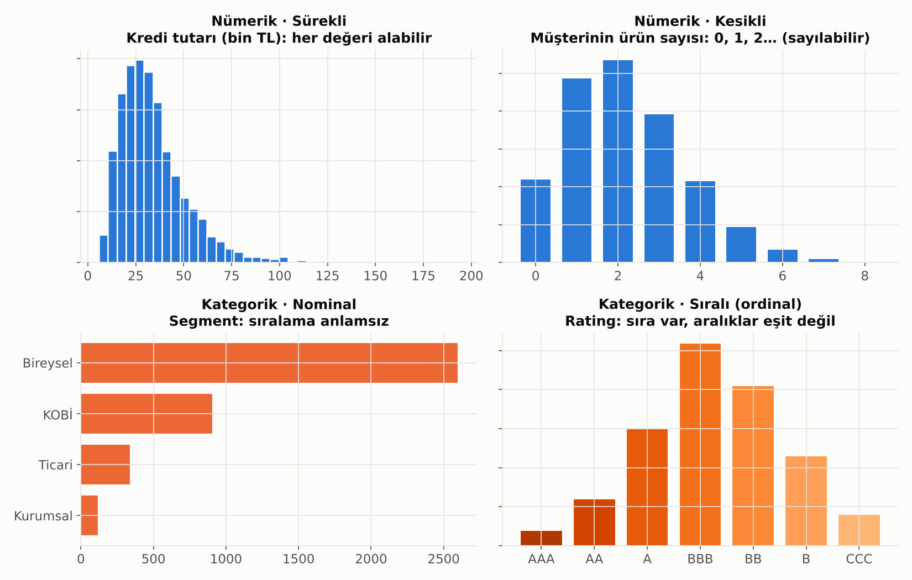

# 1. Veri Tipleri: Nümerik ve Kategorik

Her analiz aynı soruyla başlar: **Elimdeki değişken ne tür bir bilgi taşıyor?** Hangi ortalamayı alacağın, hangi grafiği çizeceğin, hangi testi kullanacağın ve modele değişkeni nasıl sokacağın bu sorunun cevabına bağlıdır.



## Ana Ayrım

```
Veri
├── Nümerik (sayısal)      → "ne kadar?" / "kaç tane?"
│   ├── Sürekli            → kredi tutarı, faiz oranı, bakiye, yaş
│   └── Kesikli            → ürün sayısı, gecikme gün sayısı, şikayet adedi
└── Kategorik              → "hangi grup?"
    ├── Nominal (isimsel)  → segment, şehir, kanal, sektör (NACE)
    └── Sıralı (ordinal)   → rating notu, risk sınıfı, eğitim düzeyi, memnuniyet (1–5)
```

## Nümerik Veri

Üzerinde **aritmetik yapmanın anlamlı olduğu** veridir: toplanır, ortalaması alınır, farkı yorumlanır.

- **Sürekli:** İki değer arasında sonsuz sayıda değer olabilir (125.430,27 TL). Histogram ve yoğunluk grafikleriyle incelenir.
- **Kesikli:** Sayılarak elde edilir, arada değer yoktur (2,5 ürün olmaz). Çubuk grafikle incelenir, genelde Poisson veya binom dağılımına uyar.

Nümerik veride ayrıca şu ayrıma dikkat et:
- **Aralık ölçeği:** Sıfır noktası keyfidir (sıcaklık °C, takvim yılı). "İki kat sıcak" demek anlamsızdır.
- **Oran ölçeği:** Gerçek bir sıfır vardır (tutar, süre, adet). "İki kat büyük kredi" demek anlamlıdır.

## Kategorik Veri

Değerler bir **etiket**tir. Sayıyla kodlanmış olsalar bile (şube kodu 1203, NACE kodu 64.19) aritmetik yapılmaz: şube kodlarının ortalaması bir şey ifade etmez.

- **Nominal:** Gruplar arasında sıra yoktur. Kurumsal, ticari, KOBİ arasında "büyüklük" sıralaması olsa bile segment etiketi kendi başına bir ölçüm değildir.
- **Sıralı (ordinal):** Sıra vardır ama **aralıklar eşit değildir**. AAA ile AA arasındaki risk farkı, B ile CCC arasındaki farkla aynı değildir. Bu yüzden rating notlarına 1, 2, 3… verip ortalamasını almak yanıltıcı olabilir.

## Neden Önemli? Tip, Yöntemi Belirler

| | Nümerik | Kategorik (nominal) | Kategorik (sıralı) |
|---|---|---|---|
| **Merkez ölçüsü** | Ortalama, medyan | Mod | Medyan, mod |
| **Yayılım** | Varyans, standart sapma, IQR | Frekans tablosu | Çeyrekler |
| **Grafik** | Histogram, kutu grafiği | Çubuk grafik | Sıralı çubuk grafik |
| **İki değişken ilişkisi** | Pearson / Spearman korelasyonu | Ki-kare testi | Spearman korelasyonu |
| **Grup karşılaştırması** | t-testi, ANOVA | Ki-kare testi | Mann-Whitney, Kruskal-Wallis |
| **Modele girişi** | Doğrudan (gerekirse ölçekleme / log) | One-hot / dummy kodlama | Sıra kodlama veya dummy |

## Modelleme İçin Pratik Notlar

- **Kategorik değişkeni sayıya çevirmek:** Nominal değişkenlerde her kategori için 0/1 sütun açılır (**one-hot / dummy**). Segmenti 1, 2, 3 diye kodlamak modele "KOBİ, ticarinin iki katıdır" gibi anlamsız bir bilgi verir.
- **Çok kategorili değişkenler:** Şube, il veya sektör gibi yüzlerce kategorisi olan değişkenlerde nadir kategoriler "Diğer" altında toplanır ya da **target encoding** (kategorinin hedef ortalaması) kullanılır. Target encoding sızıntıya (leakage) açıktır; çapraz doğrulama içinde yapılmalıdır.
- **Nümerik değişkeni kategoriye çevirmek (binning):** Kredi skorkartlarında yaş, gelir gibi değişkenler gruplara ayrılır ve her grup için **WoE** (Weight of Evidence) hesaplanır. Bu, aykırı değerlere dayanıklılık ve yorumlanabilirlik sağlar ama bilgi kaybına yol açar.
- **Tarih bir veri tipi değil, bir kaynaktır:** Tarihten ay, haftanın günü, maaş gününe uzaklık, bayram etkisi gibi hem nümerik hem kategorik değişkenler üretilir.

> 💡 Bir değişkenin veritabanındaki tipi (INTEGER, VARCHAR) ile istatistiksel tipi aynı şey değildir. Müşteri numarası INTEGER'dır ama ne nümerik ne de kategorik bir değişkendir; sadece bir **kimliktir** ve modele girmez.

---

[Bölümler](../README.md#bölümler) · [2. Veriyi Özetlemek: Tanımlayıcı İstatistik →](02_tanimlayici_istatistik.md)
