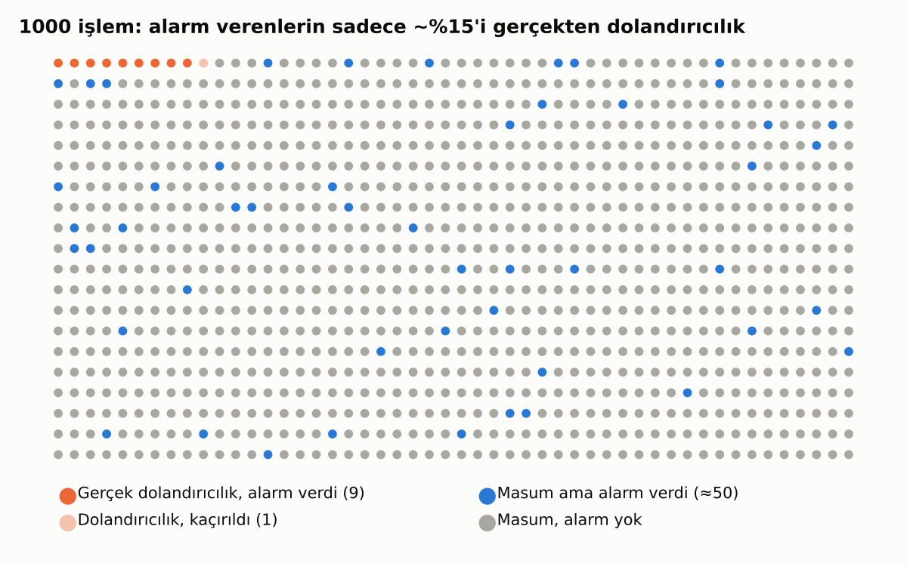

# 2. Olasılık ve Bayes Düşüncesi

## Koşullu Olasılık

"Bir müşterinin temerrüde düşme olasılığı" ile "**geçen ay ödemesini geciktirmiş** bir müşterinin temerrüde düşme olasılığı" çok farklı sayılardır. İkincisi **koşullu olasılıktır**: elimizdeki ek bilgiye göre güncellenmiş olasılık. Makine öğrenmesi modellerinin yaptığı iş özünde budur.

## Bayes Teoremi: En Çok Yanılgıya Düşülen Konu

Senaryo: Bir fraud modeli var.
- İşlemlerin **%1'i** gerçekten dolandırıcılık.
- Model, gerçek dolandırıcılıkların **%90'ını** yakalıyor.
- Masum işlemlerin ise **%5'inde** yanlışlıkla alarm veriyor.

Soru: Model alarm verdiğinde, işlemin gerçekten dolandırıcılık olma ihtimali nedir? Çoğu kişi "%90" der. Gerçek cevap yaklaşık **%15**.

Neden? Çünkü masum işlemler o kadar çok ki, onların küçük bir yüzdesi bile gerçek dolandırıcılıkların sayısını geçiyor. 1000 işlemde 9 gerçek yakalama var ama yaklaşık 50 de yanlış alarm.

> 💡 **Ders:** Nadir olayları tahmin ederken (fraud, temerrüt, kara para) alarmların çoğunun yanlış olması normaldir. Bu, operasyon ekibinin iş yükünü planlarken mutlaka hesaba katılmalı.

---

[← 1. Veriyi Özetlemek: Tanımlayıcı İstatistik](01_tanimlayici_istatistik.md) · [Bölümler](../README.md#bölümler) · [3. Dağılımlar: Verinin Şekli →](03_dagilimlar.md)
