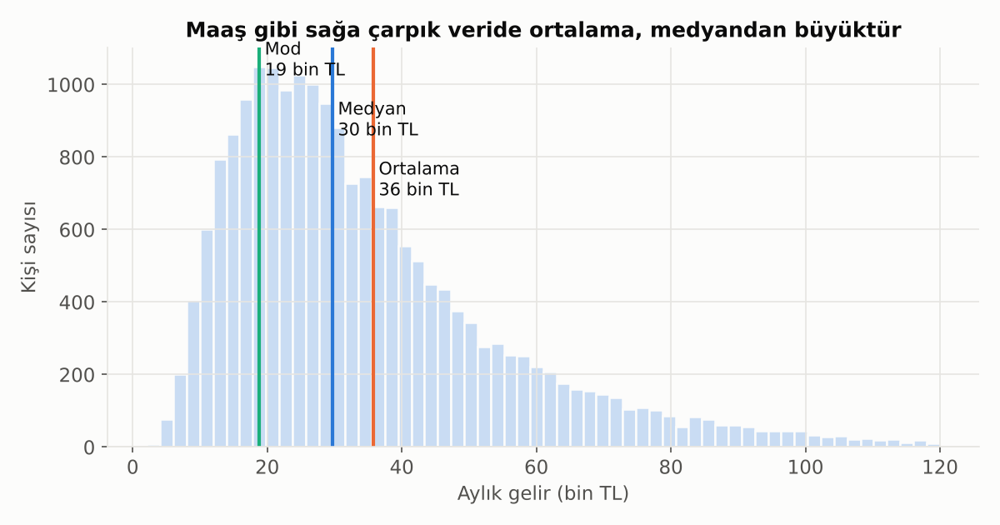
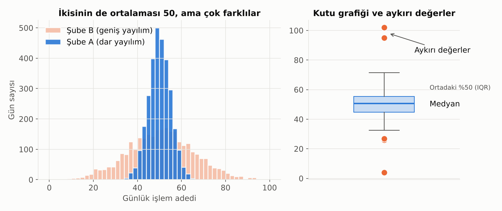
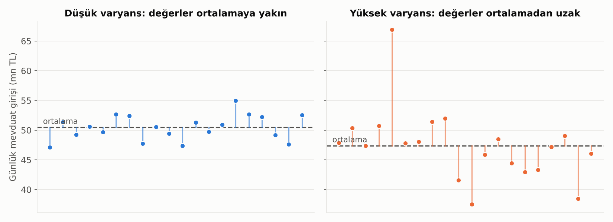
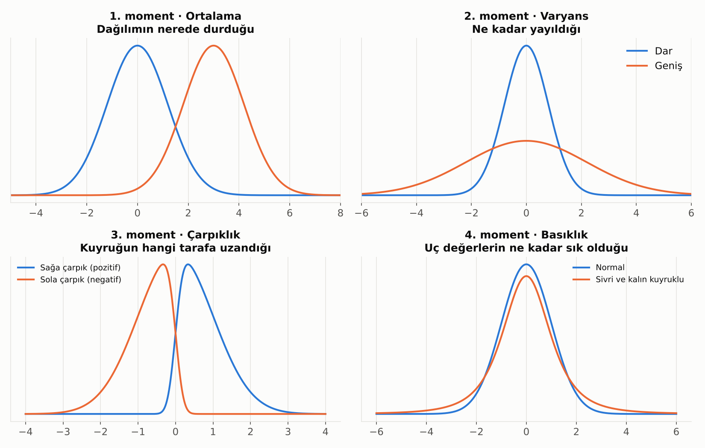

# 2. Veriyi Özetlemek: Tanımlayıcı İstatistik

## Ortalama, Medyan, Mod

Elimizde binlerce sayı var ve tek bir sayıyla "tipik değeri" söylemek istiyoruz. Üç yolu var:

- **Ortalama:** Hepsini topla, kişi sayısına böl. Herkesin eşit pay aldığı hayali dünya.
- **Medyan:** Herkesi küçükten büyüğe diz, tam ortadaki kişiye bak. Yarısı bundan az, yarısı fazla kazanır.
- **Mod:** En sık görülen değer.

**Neden önemli?** Gelir, kredi tutarı, mevduat bakiyesi gibi verilerde birkaç çok büyük değer ortalamayı yukarı çeker. Bir şubeye bir milyarder müşteri gelse ortalama bakiye fırlar ama "tipik müşteri" değişmez. Bu yüzden **çarpık veride medyan daha dürüst bir özettir.**

> 💡 Ortalama ile medyan arasındaki fark büyükse, veride uzun bir kuyruk var demektir.

## Yayılım: Varyans, Standart Sapma ve IQR

Ortalama tek başına yetmez. Aşağıdaki iki şubenin ortalaması aynı ama biri her gün neredeyse aynı sayıda işlem yaparken diğeri çok dalgalı.

### Varyans

Varyans, "değerler ortalamadan ne kadar uzaklaşıyor?" sorusunun cevabıdır. Hesaplama mantığı şöyle:

1. Her değerin ortalamaya olan uzaklığını bul.
2. Bu uzaklıkların karesini al (böylece eksiler ile artılar birbirini götürmez ve büyük sapmalar daha çok cezalandırılır).
3. Bunların ortalamasını al.

Grafikteki dikey çizgiler, her günün ortalamadan sapmasıdır. Çizgiler uzadıkça varyans büyür.

- **Varyansın birimi karesel olduğu için** (TL², gün²) doğrudan yorumlamak zordur. Bu yüzden karekökü olan **standart sapma** kullanılır; birimi verinin kendi birimidir.
- **Finans dilinde** getirilerin standart sapmasına **volatilite (oynaklık)** denir. Portföy riski, VaR ve opsiyon fiyatlaması varyans üzerine kuruludur.
- **Makine öğrenmesinde** varyans her yerdedir: varyansı sıfıra yakın bir değişken bilgi taşımaz ve çıkarılabilir; temel bileşenler analizi (PCA) varyansı en çok taşıyan yönleri bulur; regresyon "açıklanan varyans" (R²) ile değerlendirilir.

### Diğer Yayılım Ölçüleri

- **Standart sapma:** Değerlerin ortalamadan "tipik olarak" ne kadar uzaklaştığı. Küçükse veri toplu, büyükse dağınık.
- **Varyasyon katsayısı:** Standart sapmanın ortalamaya oranı. Ölçekleri farklı iki şeyin oynaklığını karşılaştırır (ör. küçük bir şubenin ve büyük bir şubenin günlük mevduat oynaklığı).
- **IQR (çeyrekler arası açıklık):** Ortadaki %50'lik dilimin genişliği. Uç değerlerden etkilenmez.
- **Kutu grafiği (boxplot):** Medyanı, ortadaki %50'yi ve aykırı değerleri tek bakışta gösterir. Veriyi tanımanın en hızlı yollarından biri.

## Aykırı Değerler

Aykırı değer her zaman "hata" değildir. Bankacılıkta bazen **en ilginç bilgi tam oradadır** (dolandırıcılık, olağandışı işlem). Silmeden önce sor: *Bu bir veri girişi hatası mı, yoksa gerçek ve nadir bir olay mı?*

## Momentler: Bir Dağılımı Dört Sayıyla Anlatmak

Bir dağılımın "şeklini" özetlemenin klasik yolu **momentler**dir. İlk dördü pratikte yeterlidir:

| Moment | Ne söyler? | Soru |
|---|---|---|
| **1. Ortalama** | Konum | Dağılım nerede duruyor? |
| **2. Varyans** | Yayılım | Ne kadar geniş? |
| **3. Çarpıklık (skewness)** | Simetri | Kuyruk hangi tarafa uzanıyor? |
| **4. Basıklık (kurtosis)** | Kuyruk kalınlığı | Uç değerler ne kadar sık? |

### Çarpıklık

- **0'a yakın:** Simetrik.
- **Pozitif (sağa çarpık):** Uzun kuyruk sağda. Gelir, kredi tutarı, mevduat bakiyesi, işlem tutarı. Ortalama medyandan büyüktür.
- **Negatif (sola çarpık):** Uzun kuyruk solda. Hisse senedi getirileri genelde hafif negatif çarpıktır: büyük düşüşler, büyük yükselişlerden daha sık görülür.

Pratik ipucu: Sağa çarpık verilerde logaritma almak çoğu zaman dağılımı toparlar ve modelleri rahatlatır.

### Basıklık

- Normal dağılımın basıklığı 3'tür. Yazılımların çoğu bunu 0 olarak raporlar (**fazla basıklık**, excess kurtosis).
- **Fazla basıklık pozitifse** dağılım ortada sivri, kuyruklarda kalındır: çoğu gün sakin geçer ama arada çok sert hareketler olur. Günlük kur ve hisse getirileri tipik örnektir.
- Basıklık yüksekse, normal dağılım varsayımıyla hesaplanan risk ölçüleri (VaR gibi) **riski olduğundan düşük gösterir.**

> 💡 Momentler veriyi hızlıca tanımak için iyidir ama aykırı değerlere çok duyarlıdır; özellikle 3. ve 4. moment tek bir uç değerle bambaşka çıkabilir. Her zaman grafikle birlikte yorumla.

---

[← 1. Veri Tipleri: Nümerik ve Kategorik](01_veri_tipleri.md) · [Bölümler](../README.md#bölümler) · [3. Olasılık ve Bayes Düşüncesi →](03_olasilik_ve_bayes.md)
