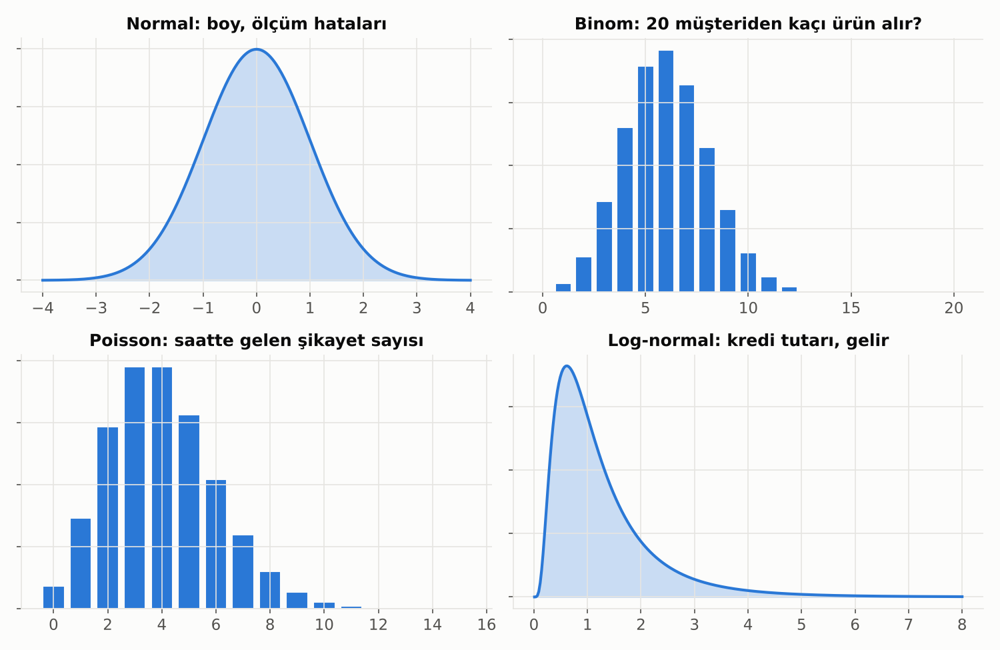
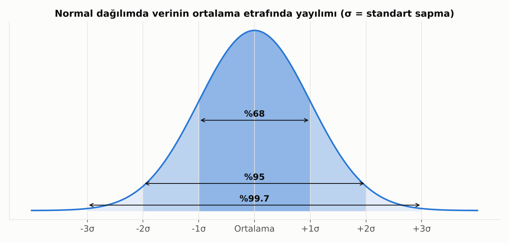
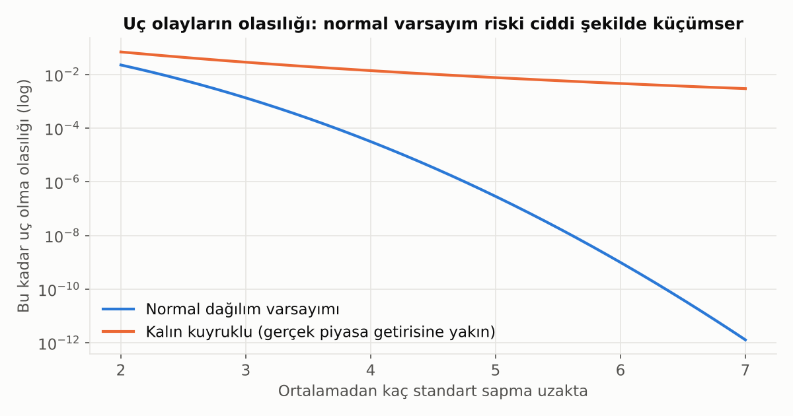
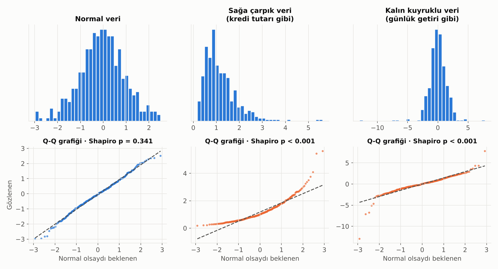

# 4. Dağılımlar: Verinin Şekli

Dağılım, "hangi değerin ne sıklıkla geldiğini" anlatan şekildir. Doğru dağılımı tanımak, doğru modeli ve doğru testi seçmenin yarısıdır.

| Dağılım | Ne zaman görülür? | Bankacılık örneği |
|---|---|---|
| **Normal (çan eğrisi)** | Birçok küçük etkinin toplamı | Ölçüm hataları, ortalamalar |
| **Binom** | "Kaç tanesi evet dedi?" | 20 müşteriden kaçı kampanyaya katıldı |
| **Poisson** | Belirli sürede kaç olay oldu? | Saatte gelen şikayet, günlük ATM arızası |
| **Log-normal** | Pozitif, sağa çarpık büyüklükler | Kredi tutarı, gelir, bakiye |

## Normal Dağılım Yakından

Normal dağılım iki sayıyla tamamen tanımlanır: **ortalama** (tepenin yeri) ve **standart sapma** (genişliği). Simetriktir; ortalama, medyan ve mod aynı noktadadır.

**68–95–99.7 kuralı:** Normal dağılan bir veride değerlerin
- yaklaşık **%68**'i ortalamanın ±1 standart sapma,
- yaklaşık **%95**'i ±2 standart sapma,
- yaklaşık **%99.7**'si ±3 standart sapma içindedir.

Bu kural, "bu değer ne kadar sıra dışı?" sorusuna hızlı bir cevap verir. Ortalamadan 3 standart sapma uzaktaki bir işlem, normal bir dünyada 370 işlemde bir görülür. Bu fikir **z-skoru** olarak bilinir ve basit anomali kurallarının temelidir.

### Neden Bu Kadar Önemli?

- **Merkezi Limit Teoremi** sayesinde ortalamalar ve toplamlar, veri normal olmasa bile normale yaklaşır (bkz. [Örneklem ve Tahmin](05_orneklem_ve_tahmin.md)).
- t-testi, ANOVA, doğrusal regresyonun güven aralıkları ve klasik VaR gibi birçok yöntem bir yerde normal dağılım varsayımına dayanır.

### Normal Dağılım Varsayımı: Neyin Normal Olması Gerekiyor?

En sık yapılan hata, **ham verinin** normal olması gerektiğini düşünmektir. Çoğu yöntemde öyle değildir:

| Yöntem | Normal olması gereken |
|---|---|
| t-testi, ANOVA | Grup **ortalamalarının** örneklem dağılımı (büyük örneklemde MLT bunu sağlar) |
| Doğrusal regresyon | **Hatalar (artıklar)**, değişkenlerin kendisi değil |
| Lojistik regresyon, ağaç modelleri | Normallik varsayımı **yok** |
| Parametrik VaR | **Getirilerin** kendisi (ve burası gerçekten sorunlu) |

Normal dağılım varsayımlarının özeti:
1. **Simetri:** Çarpıklık sıfıra yakın.
2. **Normal kuyruklar:** Fazla basıklık sıfıra yakın, uç değerler beklenenden sık değil.
3. **Bağımsız gözlemler:** Bir gözlem diğerini etkilemiyor (zaman serilerinde çoğu zaman ihlal edilir).
4. **Tek tepe:** İki farklı kitle karışmış değil (ör. bireysel ve kurumsal müşteriler aynı histogramda).

> 💡 Örneklem büyüdükçe (birkaç yüzün üstü) normallik varsayımı ortalamalar üzerine kurulu testler için önemini büyük ölçüde kaybeder. Küçük örneklemde ve uç değerlerle ilgilenen analizlerde (risk) ise kritik kalır.

## Kalın Kuyruklar: Finansın Tuzağı

Normal dağılım, uç olayların **neredeyse imkansız** olduğunu varsayar. Gerçek piyasa getirileri ise öyle değildir: büyük çöküşler, normal dağılımın söylediğinden **binlerce kat daha sık** yaşanır.

> 💡 Risk modellerinde "normal dağılım varsayalım" demek, en tehlikeli senaryoları görmezden gelmek anlamına gelebilir. Uç değerlerin sıklığını her zaman veriyle kontrol et.

## Normal Dağılım Testleri

Verinin normal olup olmadığını iki yoldan kontrol ederiz: **gözle** ve **testle**. İkisini birlikte kullan.

### Q-Q Grafiği: En Faydalı Araç

Q-Q grafiği, verideki her değeri "veri normal olsaydı burada ne görürdük?" değeriyle karşılaştırır.
- Noktalar **çizgi üzerindeyse** veri normaldir.
- **Muz şekli (bir uca doğru kıvrılma):** Çarpıklık var.
- **S şekli (iki uçta çizgiden kaçış):** Kalın kuyruklar var.

Q-Q grafiği sadece "normal değil" demekle kalmaz, **neden** normal olmadığını da gösterir.

### İstatistiksel Testler

Hepsinin sıfır hipotezi "**veri normal dağılıyor**"dur. p < 0.05 ise normallik reddedilir.

| Test | Ne zaman? | Not |
|---|---|---|
| **Shapiro-Wilk** | Küçük ve orta örneklem (≈ 5.000'e kadar) | Genelde en güçlü test, ilk tercih |
| **Kolmogorov-Smirnov (Lilliefors)** | Herhangi bir dağılımla karşılaştırma | Kuyruklara az duyarlı |
| **Anderson-Darling** | Kuyruklar önemliyse | Kuyruklara daha çok ağırlık verir, risk analizine uygun |
| **Jarque-Bera** | Büyük örneklem, finansal getiriler | Doğrudan çarpıklık ve basıklığa bakar; ekonometride standart |
| **D'Agostino K²** | Orta-büyük örneklem | Çarpıklık ve basıklığı birlikte test eder |

### Testlerin Tuzağı

- **Büyük veride** (on binlerce satır) testler, pratikte önemsiz en küçük sapmayı bile yakalar ve neredeyse her zaman "normal değil" der.
- **Küçük veride** ise testin gücü düşüktür; normal olmayan veriyi bile "normal" diye geçirebilir.

> 💡 Pratik kural: Q-Q grafiğine bak, çarpıklık ve basıklık değerlerini kontrol et, testi bunları destekleyen bir kanıt olarak kullan. "Normal değil" çıktıysa önce şunu sor: *Kullandığım yöntem gerçekten normallik istiyor mu?*

### Normal Değilse Ne Yapılır?

- **Dönüşüm:** Sağa çarpık veride logaritma veya karekök; daha genel olarak Box-Cox / Yeo-Johnson.
- **Parametrik olmayan test:** t-testi yerine Mann-Whitney, ANOVA yerine Kruskal-Wallis.
- **Bootstrap:** Dağılım varsayımı yapmadan güven aralığı.
- **Daha uygun dağılım:** Getiriler için Student-t, sayımlar için Poisson veya negatif binom.

---

[← 3. Olasılık ve Bayes Düşüncesi](03_olasilik_ve_bayes.md) · [Bölümler](../README.md#bölümler) · [5. Örneklem ve Tahmin →](05_orneklem_ve_tahmin.md)
