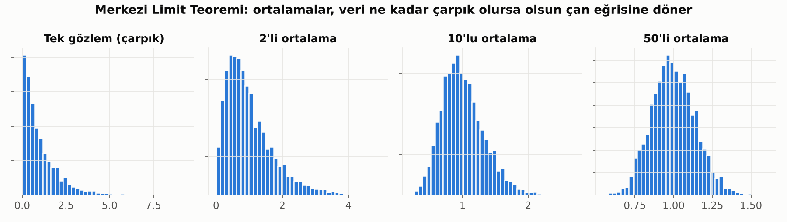
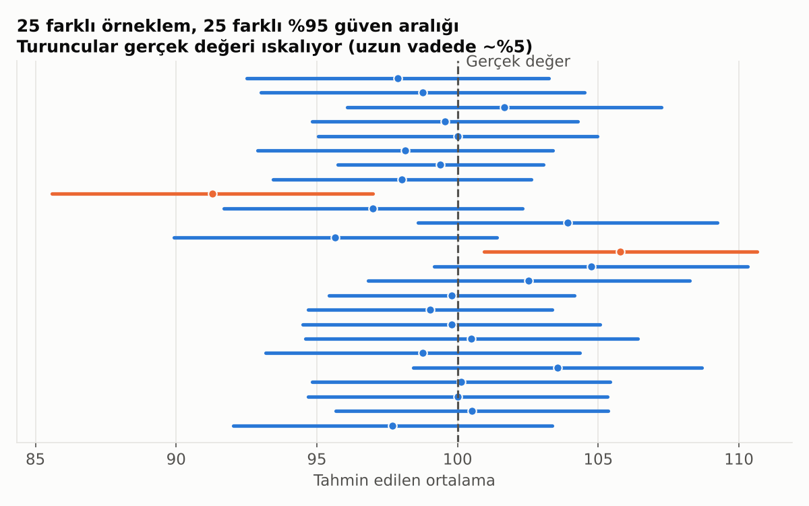

# 4. Örneklem ve Tahmin

Tüm müşterileri inceleyemeyiz; bir **örneklem** alır, oradan genel resmi tahmin ederiz. Bu bölüm, bu tahmine ne kadar güvenebileceğimizi anlatır.

## Merkezi Limit Teoremi (MLT)

İstatistiğin belki de en sihirli fikri: Veri ne kadar çarpık olursa olsun, **birçok gözlemin ortalamasını** alırsan bu ortalamalar çan eğrisine dönüşür.

**Neden önemli?** Güven aralıkları ve hipotez testlerinin büyük çoğunluğu bu teoreme yaslanır. Verin normal olmasa bile, örneklem yeterince büyükse ortalamalar hakkında güvenle konuşabilirsin.

## Büyük Sayılar Yasası

Örneklem büyüdükçe, örneklem ortalaması gerçek değere yaklaşır. 10 müşteriye bakıp "kampanya %40 tuttu" demek ile 10.000 müşteriye bakıp aynı şeyi söylemek arasında dağlar kadar fark vardır.

## Standart Hata ve Güven Aralığı

Tek bir sayı ("ortalama 100") yerine bir **aralık** ("büyük ihtimalle 96 ile 104 arası") vermek çok daha dürüsttür.

**%95 güven aralığının doğru yorumu:** Bu yöntemi defalarca uygularsan, oluşturduğun aralıkların yaklaşık %95'i gerçek değeri içerir.

- Örneklem büyüdükçe aralık **daralır** (tahmin netleşir).
- Veri dağınıklaştıkça aralık **genişler**.

## Bootstrap

Formül bilmeden güven aralığı bulmanın yolu: Elindeki veriden **iade ederek** yüzlerce yeni örneklem çek, her birinde istediğin metriği hesapla, sonuçların dağılımına bak. Medyan, oran, AUC gibi formülü karmaşık metrikler için çok pratiktir.

---

[← 3. Dağılımlar: Verinin Şekli](03_dagilimlar.md) · [Bölümler](../README.md#bölümler) · [5. Hipotez Testleri →](05_hipotez_testleri.md)
