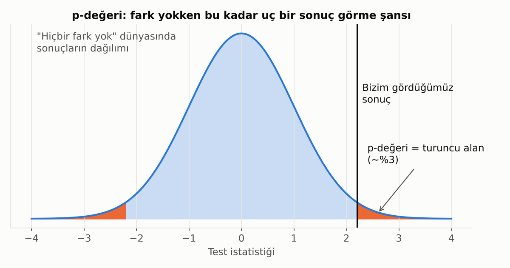
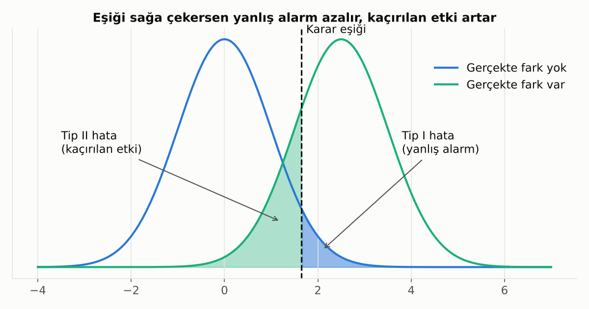
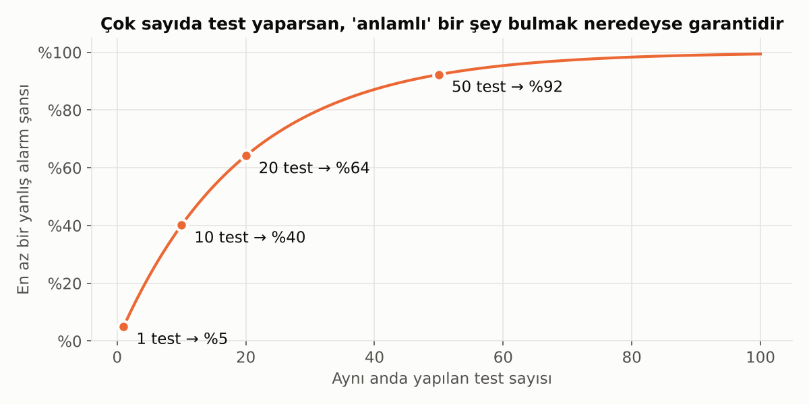

# 5. Hipotez Testleri

## Mantık

Hipotez testi bir **mahkeme** gibidir:
- Varsayılan durum: "Sanık masum" → **"Fark yok"** (sıfır hipotezi).
- Kanıt yeterince güçlüyse bu varsayımı reddederiz.
- Kanıt zayıfsa "masum" demeyiz, sadece "suçunu kanıtlayamadık" deriz.

## p-Değeri

**p-değeri:** Gerçekte hiçbir fark yokken, sırf şansla bu kadar uç (ya da daha uç) bir sonuç görme ihtimali.

- p küçükse (genelde < 0.05): "Bu sonuç şansla açıklanamayacak kadar sıra dışı" deriz.
- p **değildir:** "Hipotezin doğru olma ihtimali" ya da "etkinin büyüklüğü".

> ⚠️ **Sık hata:** Milyonlarca satırlık veride çok küçük, pratikte önemsiz farklar bile "istatistiksel olarak anlamlı" çıkar. Her zaman **etkinin büyüklüğüne** de bak: Fark anlamlı ama iş açısından değerli mi?

## Tip I ve Tip II Hata

| | Gerçekte fark yok | Gerçekte fark var |
|---|---|---|
| **"Fark var" dedik** | ❌ Tip I hata (yanlış alarm) | ✅ Doğru |
| **"Fark yok" dedik** | ✅ Doğru | ❌ Tip II hata (kaçırılan etki) |

- **Test gücü (power):** Gerçek bir fark varken onu yakalama ihtimali. Genelde %80 hedeflenir.
- İki hata arasında bir **denge** vardır: Birini azaltırken diğeri artar. Daha fazla veri toplamak ise ikisini birden azaltır.

## Hangi Test Ne Zaman?

| Soru | Test |
|---|---|
| İki grubun ortalaması farklı mı? | t-testi |
| İkiden fazla grubun ortalaması farklı mı? | ANOVA |
| İki kategorik değişken ilişkili mi? (ör. segment × ürün kullanımı) | Ki-kare testi |
| Veri çok çarpık ya da sıralı, ortalamalar yanıltıcı | Mann-Whitney, Kruskal-Wallis (parametrik olmayan testler) |
| İki dağılım aynı mı? | Kolmogorov-Smirnov |

## Çoklu Test Problemi

Her testte %5 yanlış alarm riski varsa ve 20 farklı test yaparsan, **en az birinde** sırf şansla "anlamlı" sonuç bulma ihtimalin %64'tür.

Çözümler: Bonferroni düzeltmesi (eşiği test sayısına böl) veya daha esnek olan FDR kontrolü. Pratikteki ders: **Önce hipotezini yaz, sonra veriye bak.** "Bir şey çıkana kadar her şeyi test etmek" (p-hacking) en yaygın tuzaklardan biridir.

## A/B Testi

Hipotez testinin iş dünyasındaki en yaygın hali. İyi bir A/B testi için:

1. **Önceden** başarı metriğini ve gereken örneklem büyüklüğünü belirle.
2. Müşterileri gruplara **rastgele** ata.
3. Test bitmeden sonuçlara bakıp erken durdurma (bu da bir çeşit p-hacking).
4. Hem istatistiksel anlamlılığa hem de iş etkisine bak.

---

[← 4. Örneklem ve Tahmin](04_orneklem_ve_tahmin.md) · [Bölümler](../README.md#bölümler) · [6. Korelasyon ve Regresyon →](06_korelasyon_ve_regresyon.md)
