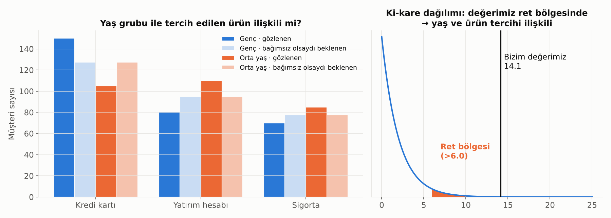

# 6. Hipotez Testleri

## Mantık

Hipotez testi bir **mahkeme** gibidir:
- Varsayılan durum: "Sanık masum" → **"Fark yok"** (sıfır hipotezi).
- Kanıt yeterince güçlüyse bu varsayımı reddederiz.
- Kanıt zayıfsa "masum" demeyiz, sadece "suçunu kanıtlayamadık" deriz.

## p-Değeri

**p-değeri:** Gerçekte hiçbir fark yokken, sırf şansla bu kadar uç (ya da daha uç) bir sonuç görme ihtimali.

- p küçükse (genelde < 0.05): "Bu sonuç şansla açıklanamayacak kadar sıra dışı" deriz.
- p **değildir:** "Hipotezin doğru olma ihtimali" ya da "etkinin büyüklüğü".

> ⚠️ **Sık hata:** Milyonlarca satırlık veride çok küçük, pratikte önemsiz farklar bile "istatistiksel olarak anlamlı" çıkar. Her zaman **etkinin büyüklüğüne** de bak: Fark anlamlı ama iş açısından değerli mi?

## Tip I ve Tip II Hata

| | Gerçekte fark yok | Gerçekte fark var |
|---|---|---|
| **"Fark var" dedik** | ❌ Tip I hata (yanlış alarm) | ✅ Doğru |
| **"Fark yok" dedik** | ✅ Doğru | ❌ Tip II hata (kaçırılan etki) |

- **Test gücü (power):** Gerçek bir fark varken onu yakalama ihtimali. Genelde %80 hedeflenir.
- İki hata arasında bir **denge** vardır: Birini azaltırken diğeri artar. Daha fazla veri toplamak ise ikisini birden azaltır.

## Hangi Test Ne Zaman?

| Soru | Test |
|---|---|
| İki grubun ortalaması farklı mı? | t-testi |
| İkiden fazla grubun ortalaması farklı mı? | ANOVA |
| İki kategorik değişken ilişkili mi? (ör. segment × ürün kullanımı) | Ki-kare testi |
| Veri çok çarpık ya da sıralı, ortalamalar yanıltıcı | Mann-Whitney, Kruskal-Wallis (parametrik olmayan testler) |
| İki dağılım aynı mı? | Kolmogorov-Smirnov |

## Ki-Kare (χ²) Testi

İki **kategorik** değişken arasında ilişki olup olmadığını test eder. Ortalama alınamayan veriler için (segment, ürün, kanal, il) t-testinin karşılığıdır.

**Örnek soru:** Müşterinin yaş grubu ile tercih ettiği ürün arasında bir ilişki var mı?

### Mantığı

1. **Gözlenen** tabloyu çıkar: Her yaş grubu–ürün kombinasyonunda kaç müşteri var?
2. **Beklenen** tabloyu hesapla: İki değişken tamamen bağımsız olsaydı, yani yaş ürün tercihini hiç etkilemeseydi, her hücrede kaç müşteri olurdu? (Gençlerin toplam içindeki payı × o ürünü alanların sayısı.)
3. Her hücrede gözlenen ile beklenen arasındaki farka bak. Farklar büyüdükçe ki-kare değeri büyür.
4. Bu değer, "bağımsızlık" dünyasında beklenenden çok büyükse ilişki var deriz.

Grafikte gençler beklenenden çok daha fazla kredi kartı, orta yaşlılar ise daha fazla yatırım hesabı almış. Ki-kare değeri 14.1, p-değeri 0.001'in altında: yaş grubu ile ürün tercihi **ilişkili**.

### Ki-Karenin Üç Kullanımı

| Kullanım | Soru | Bankacılık örneği |
|---|---|---|
| **Bağımsızlık testi** | İki kategorik değişken ilişkili mi? | Kanal × ürün, segment × temerrüt durumu |
| **Uyum iyiliği testi** | Gözlenen dağılım beklenen dağılıma uyuyor mu? | Rating dağılımı geçen yılkiyle aynı mı? Şikayetler haftanın günlerine eşit mi dağılıyor? |
| **Homojenlik testi** | Farklı gruplarda aynı kategorik dağılım mı var? | İki şubenin müşteri segment dağılımı aynı mı? |

### Dikkat Edilecekler

- **Hücre başına beklenen değer en az 5 olmalı.** Az gözlemli kategorileri birleştir ya da küçük tablolar için **Fisher'ın kesin testi**ni kullan.
- Ki-kare sadece **ilişki var mı** der; ilişkinin **gücünü** söylemez. Güç için **Cramér's V** kullanılır (0 = ilişki yok, 1 = tam ilişki). Büyük veride çok zayıf ilişkiler bile anlamlı çıkar.
- Gözlemler bağımsız olmalı: Aynı müşteri tabloda birden çok kez sayılmamalı.
- Ki-kare, değişken seçimi için de kullanılır: Kategorik bir değişkenin hedefle (temerrüt var/yok) ilişkisi yoksa modele katkısı da olmayacaktır.

## Çoklu Test Problemi

Her testte %5 yanlış alarm riski varsa ve 20 farklı test yaparsan, **en az birinde** sırf şansla "anlamlı" sonuç bulma ihtimalin %64'tür.

Çözümler: Bonferroni düzeltmesi (eşiği test sayısına böl) veya daha esnek olan FDR kontrolü. Pratikteki ders: **Önce hipotezini yaz, sonra veriye bak.** "Bir şey çıkana kadar her şeyi test etmek" (p-hacking) en yaygın tuzaklardan biridir.

## A/B Testi

Hipotez testinin iş dünyasındaki en yaygın hali. İyi bir A/B testi için:

1. **Önceden** başarı metriğini ve gereken örneklem büyüklüğünü belirle.
2. Müşterileri gruplara **rastgele** ata.
3. Test bitmeden sonuçlara bakıp erken durdurma (bu da bir çeşit p-hacking).
4. Hem istatistiksel anlamlılığa hem de iş etkisine bak.

---

[← 5. Örneklem ve Tahmin](05_orneklem_ve_tahmin.md) · [Bölümler](../README.md#bölümler) · [7. Korelasyon ve Doğrusal Regresyon →](07_korelasyon_ve_dogrusal_regresyon.md)
