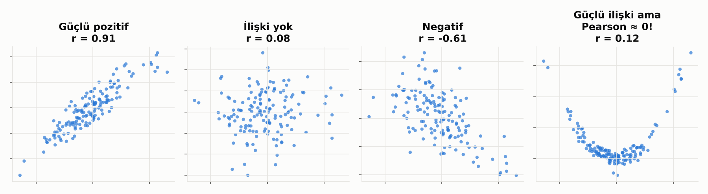
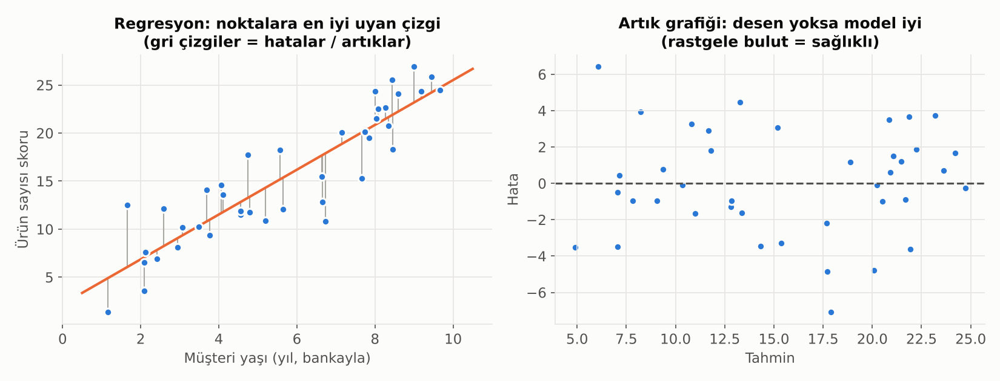
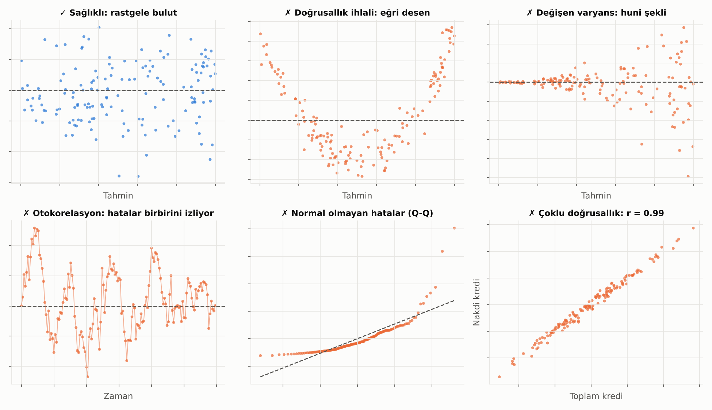

# 7. Korelasyon ve Doğrusal Regresyon

## Korelasyon

İki değişkenin **birlikte hareket etme** derecesi. -1 ile +1 arasında bir sayıdır.

Dikkat edilecek üç nokta:
1. **Pearson korelasyonu sadece doğrusal ilişkiyi ölçer.** Sağdaki grafikte çok güçlü bir ilişki var ama korelasyon sıfıra yakın. Her zaman önce grafiğe bak.
2. **Spearman korelasyonu** sıralamaya bakar; aykırı değerlere ve doğrusal olmayan (ama tek yönlü) ilişkilere karşı daha dayanıklıdır.
3. **Korelasyon nedensellik değildir.** Dondurma satışı ile boğulma vakaları birlikte artar; sebep ikisinin de yazın artmasıdır.

## Doğrusal Regresyon

Noktaların arasından geçen "en iyi" çizgiyi bulur. Her noktanın çizgiye olan dikey uzaklığı **hata (artık)** olarak adlandırılır; regresyon bu hataları toplamda en küçük yapan çizgiyi seçer.

**Katsayı yorumu:** "Diğer her şey sabitken, X bir birim artınca Y ortalama şu kadar artar."

**Artık grafiği** modelin sağlık raporudur:
- Rastgele bir bulut → model iyi.
- Eğri, huni ya da dalga şekli → model bir şeyi kaçırıyor.

## Doğrusal Regresyonun Varsayımları

Doğrusal regresyon her veriye bir çizgi çizer; çizginin **güvenilir** olması ise bazı varsayımlara bağlıdır. Varsayımların çoğu değişkenlerle değil, **hatalarla (artıklarla)** ilgilidir. Kontrol etmenin en iyi yolu artık grafikleridir.

Kolay hatırlamak için İngilizce kısaltması **LINE**: **L**inearity, **I**ndependence, **N**ormality, **E**qual variance. Buna çoklu doğrusallığın olmaması da eklenir.

| # | Varsayım | Ne demek? | Nasıl kontrol edilir? | İhlal edilirse |
|---|---|---|---|---|
| 1 | **Doğrusallık** | X ile Y arasındaki ilişki gerçekten düz bir çizgi | Artık – tahmin grafiğinde eğri desen olmamalı | Değişkeni dönüştür (log, kare), etkileşim terimi ekle ya da doğrusal olmayan model kullan |
| 2 | **Hataların bağımsızlığı** | Bir gözlemin hatası diğerini etkilemiyor | Zamana göre artık grafiği, **Durbin-Watson** testi (2'ye yakın olmalı) | Zaman serisi yöntemleri, gecikmeli değişkenler, Newey-West standart hataları |
| 3 | **Hataların normalliği** | Hatalar çan eğrisi şeklinde dağılıyor | Artıkların Q-Q grafiği, Shapiro-Wilk, Jarque-Bera | Tahmin etkilenmez ama güven aralıkları ve p-değerleri bozulur; büyük örneklemde sorun azalır; bootstrap kullan |
| 4 | **Sabit varyans (homoskedastisite)** | Hataların büyüklüğü her seviyede aynı | Artık – tahmin grafiğinde huni şekli olmamalı; **Breusch-Pagan**, White testi | Hedefi log'la, ağırlıklı regresyon ya da **robust (HC) standart hatalar** |
| 5 | **Çoklu doğrusallık olmaması** | Açıklayıcı değişkenler birbirinin kopyası değil | Korelasyon matrisi, **VIF** (5–10 üstü alarm) | Değişkenlerden birini çıkar, birleştir ya da PCA / Ridge kullan |

Bunlara ek olarak:
- **Aykırı ve etkili gözlemler:** Tek bir uç gözlem çizgiyi kendine doğru çekebilir. **Cook's distance** ile etkili gözlemler bulunur.
- **Doğru değişkenlerin modelde olması:** Önemli bir değişkeni dışarıda bırakmak, kalan katsayıları yanlı hale getirir (bkz. [Nedensellik](15_nedensellik_ve_bayesci_dusunce.md)).

### Hangi İhlal Ne Kadar Önemli?

- **Tahmin** yapıyorsan (ör. bakiye tahmini) en kritik olanlar doğrusallık ve bağımsızlıktır.
- **Yorum** yapıyorsan (ör. "faizdeki 1 puanlık artış kredi talebini ne kadar düşürür?") hepsi önemlidir, çünkü katsayıların güven aralıkları ve p-değerleri bu varsayımlara dayanır.

> 💡 Lojistik regresyonun varsayımları farklıdır; bir sonraki bölümde: [Lojistik Regresyon, Sigmoid ve Softmax](08_lojistik_regresyon_sigmoid_softmax.md).

---

[← 6. Hipotez Testleri](06_hipotez_testleri.md) · [Bölümler](../README.md#bölümler) · [8. Lojistik Regresyon, Sigmoid ve Softmax →](08_lojistik_regresyon_sigmoid_softmax.md)
