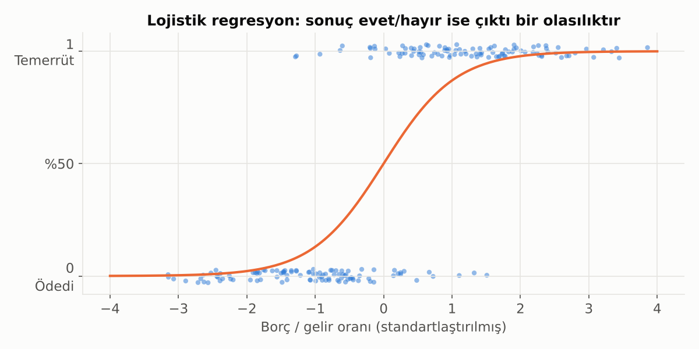
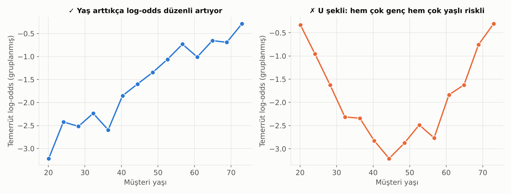
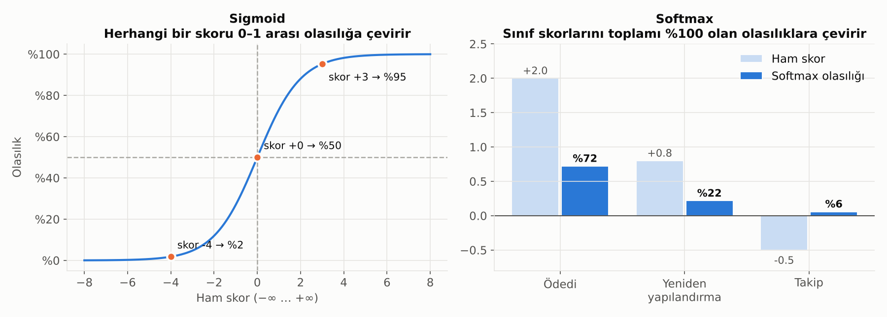

# 8. Lojistik Regresyon, Sigmoid ve Softmax

## Lojistik Regresyon

Sonuç "evet/hayır" ise (temerrüt etti mi, ürünü aldı mı, fraud mu) kullanılır. Düz bir çizgi yerine 0 ile 1 arasında kalan **S şeklinde** bir eğri çizer; çıktısı bir **olasılıktır**.

**Neden doğrusal regresyon kullanmıyoruz?** Düz bir çizgi bazı müşteriler için %130 ya da −%20 temerrüt olasılığı tahmin eder. Olasılık 0 ile 1 arasında kalmalıdır; lojistik regresyon bunu sigmoid fonksiyonuyla sağlar.

### Katsayıların Yorumu: Odds ve Log-Odds

- **Odds (bahis oranı):** Olma olasılığının olmama olasılığına oranı. %20 temerrüt olasılığı = 0.20 / 0.80 = **1'e 4** odds.
- Lojistik regresyon, arka planda **log-odds** üzerinde doğrusal bir model kurar.
- Bu yüzden bir katsayı şöyle yorumlanır: "Borç/gelir oranı bir birim artınca temerrüt **odds'u** şu kadar **kat** artar." Bu "kat" değerine **odds oranı** denir.

Bankacılıkta kredi skorkartlarının büyük çoğunluğu hâlâ lojistik regresyonla kurulur; çünkü yorumlanabilir, kararlı ve düzenleyicilere açıklanması kolaydır. Skorkartlardaki "puan" aslında ölçeklenmiş log-odds'tur: Örneğin "her 20 puan, odds'u iki katına çıkarır."

## Lojistik Regresyonun Varsayımları

Lojistik regresyon, doğrusal regresyondan **çok daha az** varsayım yapar. Şunlar **gerekmez**:
- Hataların normal dağılması
- Sabit varyans
- X ile Y arasında doğrusal ilişki (Y zaten 0/1)

Şunlar **gerekir**:

| # | Varsayım | Ne demek? | Nasıl kontrol edilir? |
|---|---|---|---|
| 1 | **İkili (ya da sıralı/çok sınıflı) hedef** | Hedef değişken uygun tipte | Veri tipi kontrolü; çok sınıflı için multinomial lojistik |
| 2 | **Gözlemlerin bağımsızlığı** | Aynı müşteri farklı satırlarda tekrar etmiyor, gözlemler birbirini etkilemiyor | Veri yapısı; panel veride müşteri bazlı kümelenmiş standart hata |
| 3 | **Log-odds ile doğrusallık** | Nümerik değişkenler, **log-odds** ile düz bir ilişki içinde | Değişkeni gruplayıp her grubun log-odds'unu çiz; Box-Tidwell testi |
| 4 | **Çoklu doğrusallık olmaması** | Açıklayıcı değişkenler birbirinin kopyası değil | VIF, korelasyon matrisi |
| 5 | **Yeterli örneklem** | Özellikle az görülen sınıfta yeterli olay sayısı | Kaba kural: değişken başına en az 10–20 "olay" (temerrüt) |
| 6 | **Aşırı etkili gözlem olmaması** | Tek bir gözlem modeli sürüklemiyor | Cook's distance, leverage |

### En Sık İhlal Edilen: Log-Odds ile Doğrusallık

Solda yaş arttıkça temerrüt log-odds'u düzenli artıyor: Yaşı modele olduğu gibi koyabiliriz. Sağda ise ilişki **U şeklinde**: Hem çok genç hem çok yaşlı müşteriler daha riskli. Yaşı doğrudan modele koyarsak model bu deseni göremez ve "yaşın etkisi yok" sonucuna varabilir.

**Çözümler:**
- Değişkeni gruplara ayırıp **WoE dönüşümü** yapmak (skorkartlarda standart yaklaşım; WoE tanımı gereği log-odds ile doğrusaldır).
- Kare terim veya spline eklemek.
- Değişkeni log almak.

### Ayrılma (Separation) Problemi

Bir değişken hedefi **mükemmel** ayırıyorsa (ör. "takipteki kredisi var" olan herkes temerrüde düşmüş), katsayı sonsuza gider ve model tahmin edilemez. Bu genelde bir **veri sızıntısı** işaretidir. Değişkeni kontrol et; gerekirse düzenlileştirme (L1/L2) kullan.

## Sigmoid Fonksiyonu

Sigmoid, **herhangi bir sayıyı** (eksi sonsuzdan artı sonsuza) **0 ile 1 arasına sıkıştıran** S şeklinde bir fonksiyondur.

- Ham skor 0 ise olasılık **%50**.
- Skor büyüdükçe olasılık 1'e, küçüldükçe 0'a yaklaşır ama hiçbir zaman tam olarak ulaşmaz.
- Ortada **dik**, uçlarda **yatıktır**: Skordaki aynı artış, olasılığı %50 civarında çok, %98 civarında çok az değiştirir.

**Nerede kullanılır?**
- **Lojistik regresyon:** Değişkenlerin ağırlıklı toplamı (log-odds) sigmoid'den geçirilir, olasılık elde edilir.
- **İkili sınıflandırma yapan sinir ağlarının** son katmanı.
- **Gradient boosting** (XGBoost, LightGBM) ikili sınıflandırmada ağaçların ürettiği toplam skoru sigmoid ile olasılığa çevirir.

> 💡 Sigmoid ve log-odds birbirinin tersidir: Log-odds olasılığı sayı doğrusuna açar, sigmoid geri kapatır.

## Softmax Fonksiyonu

Softmax, sigmoid'in **ikiden fazla sınıfa genelleştirilmiş** halidir. Her sınıf için hesaplanan ham skorları, **toplamı %100 olan** olasılıklara çevirir.

**Örnek:** Gecikmedeki bir kredinin üç olası sonucu var: ödeme, yeniden yapılandırma, takip. Model her biri için bir skor üretir: +2.0, +0.8, −0.5. Softmax bunları sırasıyla yaklaşık **%72, %22 ve %6** olasılığa çevirir.

Mantığı:
1. Her skoru pozitif bir sayıya çevir (üssünü al). Böylece negatif skorlar da pozitif olur ve büyük skorlar daha da öne çıkar.
2. Her birini toplama böl, toplam 1 olsun.

**Özellikleri:**
- En yüksek skorlu sınıf en yüksek olasılığı alır, ama diğerleri de sıfır olmaz (adı buradan gelir: "yumuşak maksimum").
- Skorların hepsine aynı sayıyı eklemek sonucu değiştirmez; önemli olan **skorlar arasındaki farklardır.**
- İki sınıflı durumda softmax, sigmoid ile aynı sonucu verir.

**Nerede kullanılır?**
- **Multinomial lojistik regresyon** (ör. müşterinin hangi ürünü alacağı).
- Çok sınıflı sinir ağlarının son katmanı (ör. işlem kategorisi sınıflandırma, belge türü tanıma).
- Dil modellerinde bir sonraki kelimenin seçimi.

| | Sigmoid | Softmax |
|---|---|---|
| Sınıf sayısı | 2 (evet/hayır) | 2 veya daha fazla |
| Çıktı | Tek bir olasılık | Her sınıf için bir olasılık, toplamı %100 |
| Sınıflar | Bağımsız da olabilir (çok etiketli) | Birbirini dışlar (tek etiket) |
| Örnek | Temerrüt olur mu? | Hangi ürünü alır? |

> 💡 Bir müşteri **aynı anda birden fazla** ürünü alabiliyorsa (çok etiketli problem), softmax değil her ürün için ayrı bir sigmoid kullanılır.

---

[← 7. Korelasyon ve Doğrusal Regresyon](07_korelasyon_ve_dogrusal_regresyon.md) · [Bölümler](../README.md#bölümler) · [9. Temel Bileşenler Analizi (PCA) →](09_temel_bilesenler_analizi.md)
