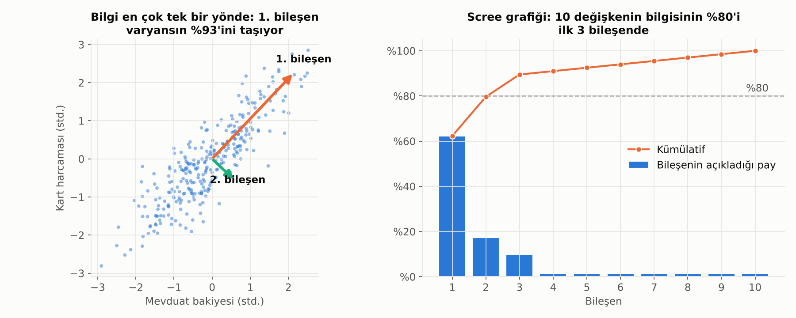

# 9. Temel Bileşenler Analizi (PCA)

## Problem: Çok Fazla, Birbirine Benzeyen Değişken

Bir müşteri için yüzlerce değişkenimiz olabilir: son 1, 3, 6, 12 ayın ortalama bakiyesi, maksimum bakiyesi, kart harcaması, işlem adedi… Bunların çoğu **aynı bilgiyi** farklı açılardan tekrar eder. Son 3 ayın ortalama bakiyesi yüksek olan müşterinin son 6 ayınki de büyük ihtimalle yüksektir.

Bu durum:
- Modelleri yavaşlatır ve aşırı öğrenmeye (overfitting) iter,
- Regresyonda çoklu doğrusallık yaratır,
- Veriyi görselleştirmeyi imkânsız kılar.

**PCA**, birbiriyle ilişkili çok sayıda değişkeni, bilginin büyük kısmını koruyarak **birbirinden bağımsız az sayıda yeni değişkene** (bileşene) özetler.

## Sezgisel Anlatım

Soldaki grafikte mevduat bakiyesi ile kart harcaması birlikte artıyor. Noktalar köşegen bir bulut oluşturuyor.

1. PCA önce verinin **en çok yayıldığı (varyansın en büyük olduğu) yönü** bulur. Bu, **1. bileşendir** (turuncu ok). Bu örnekte kabaca "müşterinin genel finansal büyüklüğü" anlamına gelir.
2. Sonra buna **dik** olan ve kalan yayılımın en büyük olduğu yönü bulur. Bu, **2. bileşendir** (yeşil ok). Burada "harcamaya mı yoksa birikime mi eğilimli" gibi bir farkı yakalar.
3. Değişken sayısı kadar bileşen çıkarılabilir, ama genelde ilk birkaçı bilginin çoğunu taşır.

Bu örnekte 1. bileşen tek başına toplam varyansın %92'sini açıklıyor: İki değişken yerine tek bir sayı kullanarak bilginin çok az bir kısmını kaybederiz.

Benzetme: Bir binanın fotoğrafını çekerken, binanın en çok bilgi veren açısını seçmek gibidir. Üç boyutlu nesne iki boyutlu fotoğrafa iner, ama doğru açıdan çekilirse ne olduğu hâlâ anlaşılır.

## Kaç Bileşen Seçmeli?

Sağdaki **scree grafiği**, her bileşenin açıkladığı varyans payını gösterir.

- **Kümülatif varyans eşiği:** Toplam varyansın %80–90'ını açıklayan bileşen sayısı. Burada 10 değişkenin bilgisinin %80'inden fazlası ilk 2 bileşende.
- **Dirsek kuralı:** Grafiğin kırıldığı ve düzleştiği nokta.
- **Kaiser kuralı:** Standartlaştırılmış veride özdeğeri 1'den büyük olan bileşenler.

## Dikkat Edilecekler

- **Önce standartlaştır.** PCA varyansa bakar; TL cinsinden bakiye (milyonlar) ile işlem adedi (onlar) aynı ölçekte değilse bakiye her şeye hâkim olur. Her değişkeni ortalaması 0, standart sapması 1 olacak şekilde ölçekle.
- **Yorumlanabilirlik kaybolur.** Bileşenler orijinal değişkenlerin karışımıdır. "1. bileşen 0.3 arttı" demek, "bakiye arttı" demek kadar anlaşılır değildir. Bileşenlerin **yüklerine** (her değişkenin bileşene katkısı) bakarak anlam verilmeye çalışılır.
- **Sadece doğrusal ilişkileri yakalar.** Doğrusal olmayan yapılar için t-SNE, UMAP veya autoencoder gibi yöntemler kullanılır (bunlar daha çok görselleştirme içindir).
- **Aykırı değerlere duyarlıdır.** Varyansa dayandığı için tek bir uç değer bileşenin yönünü değiştirebilir.
- **Hedef değişkeni görmez.** PCA, hedefle en ilgili yönü değil, en çok **yayılan** yönü bulur. Bazen hedefi açıklayan bilgi küçük varyanslı bir bileşende kalabilir.
- **Veri sızıntısına dikkat.** PCA sadece eğitim verisi üzerinde öğrenilmeli, test verisine aynı dönüşüm uygulanmalı.

## Bankacılıkta Kullanım Alanları

- **Faiz eğrisi analizi:** Farklı vadelerdeki faizlerin hareketi üç bileşenle neredeyse tamamen açıklanır: **seviye** (tüm eğri birlikte kayar), **eğim** (kısa ve uzun vade ayrışır), **eğrilik** (orta vade farklı hareket eder). Hazine ve ALM tarafında standart bir yöntemdir.
- **Değişken azaltma:** Çok sayıda davranışsal değişkenin olduğu modellerde girdi sayısını düşürmek.
- **Anomali tespiti:** Veriyi ilk birkaç bileşenle geri oluşturmaya çalışırsın; geri oluşturulamayan (yeniden oluşturma hatası büyük olan) gözlemler sıra dışıdır.
- **Görselleştirme:** Yüzlerce boyutlu müşteri verisini 2 boyuta indirip segmentleri gözle incelemek.
- **Makro göstergelerden endeks üretmek:** Birçok ekonomik göstergeden tek bir "finansal koşullar endeksi" çıkarmak.

---

[← 8. Lojistik Regresyon, Sigmoid ve Softmax](08_lojistik_regresyon_sigmoid_softmax.md) · [Bölümler](../README.md#bölümler) · [10. Model Değerlendirme →](10_model_degerlendirme.md)
