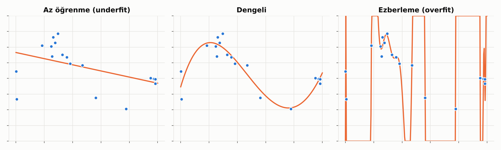
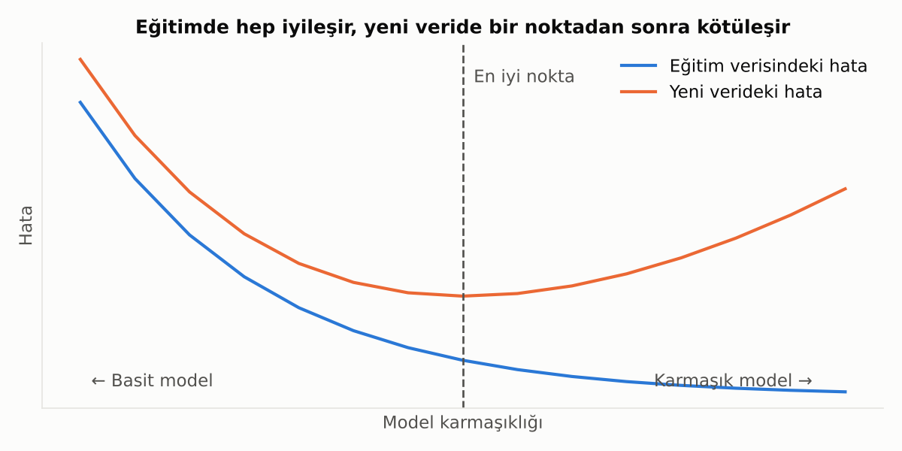
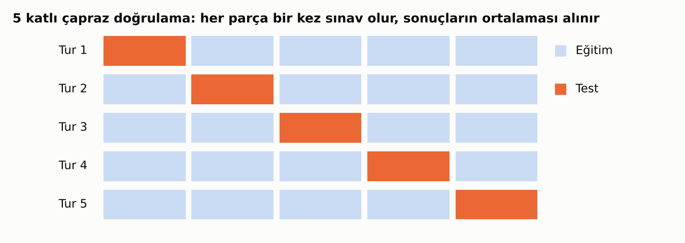
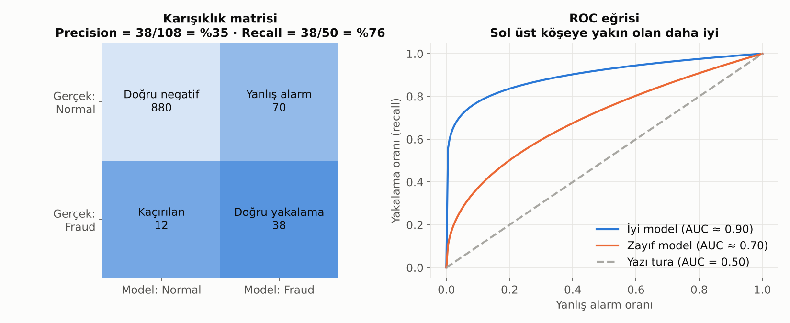
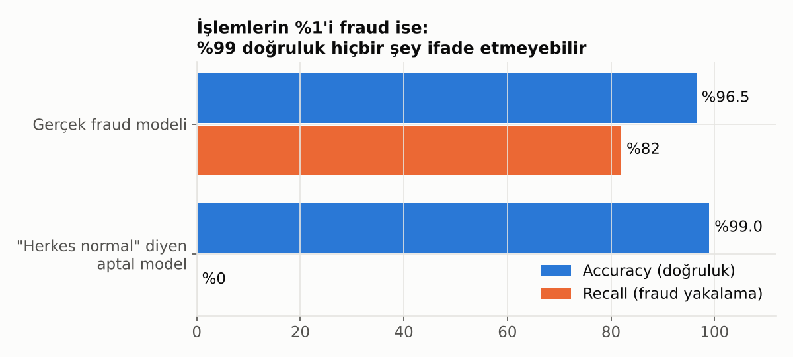
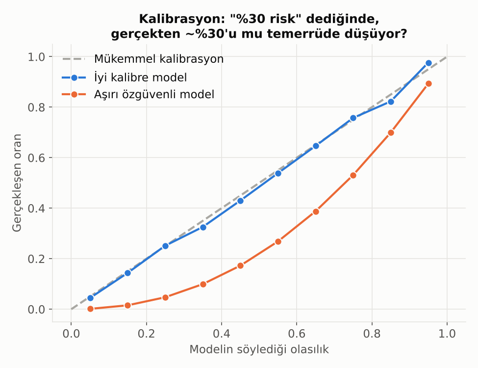

# 10. Model Değerlendirme

## Overfitting: Ezberleme Problemi

Model, eğitim verisindeki **gürültüyü de öğrenirse** yeni veride kötü performans gösterir. Tıpkı sınav sorularını ezberleyip konuyu anlamayan bir öğrenci gibi.

## Bias-Variance Dengesi

- **Çok basit model (yüksek bias):** Gerçek deseni yakalayamaz. Hem eğitimde hem testte kötü.
- **Çok karmaşık model (yüksek varyans):** Gürültüyü ezberler. Eğitimde mükemmel, testte kötü.

> 💡 Eğitim skoru ile test skoru arasındaki **fark** büyüyorsa, model ezberliyor demektir.

## Çapraz Doğrulama (Cross-Validation)

Veriyi tek bir kez eğitim/test olarak bölmek şansa bağlıdır. Çapraz doğrulamada veri parçalara ayrılır ve her parça sırayla test seti olur.

> ⚠️ Zaman içeren verilerde (kredi performansı, işlem geçmişi) rastgele bölme yapma; **geçmişle eğit, gelecekle test et.** Aksi halde model "geleceği görerek" sahte bir başarı gösterir.

## Karışıklık Matrisi, Precision, Recall

Sınıflandırma modelinin dört olası sonucu vardır:

- **Precision (kesinlik):** Alarm verdiklerimizin ne kadarı gerçekten pozitif? → "Alarmlarıma ne kadar güvenebilirim?"
- **Recall (duyarlılık):** Gerçek pozitiflerin ne kadarını yakaladık? → "Kaçını kaçırıyorum?"
- **F1:** İkisinin dengeli bir özeti.

Hangisinin önemli olduğu iş problemine bağlıdır:
- **Fraud:** Kaçırmak pahalıysa recall öncelikli.
- **Pazarlama kampanyası:** Her arama maliyetliyse precision öncelikli.

## ROC Eğrisi ve AUC

Modelin karar eşiğini değiştirdikçe yakalama oranı ile yanlış alarm oranının nasıl değiştiğini gösterir.
- **AUC = 0.5:** Yazı tura atmakla aynı.
- **AUC = 1.0:** Mükemmel ayrım.
- Bankacılıkta Gini katsayısı da sık kullanılır; AUC'nin yeniden ölçeklenmiş halidir (Gini = 2 × AUC − 1).

## Dengesiz Sınıflar: Accuracy Tuzağı

İşlemlerin %1'i fraud ise, **"hiçbiri fraud değil"** diyen tembel bir model %99 doğruluk (accuracy) elde eder ama hiçbir işe yaramaz.

Dengesiz veride:
- Accuracy yerine **precision, recall, F1, PR-AUC** kullan.
- Sınıf ağırlıklandırma veya örnekleme teknikleri (oversampling/undersampling) düşün.
- Karar eşiğini varsayılan 0.5'te bırakma; iş maliyetine göre ayarla.

## Kalibrasyon

Model "%30 risk" diyorsa, bu müşterilerin gerçekten yaklaşık %30'u mu temerrüde düşüyor? İyi ayırt eden (yüksek AUC) bir model bile **kötü kalibre** olabilir.

**Neden önemli?** Fiyatlama, karşılık (provizyon) hesabı ve sermaye yeterliliği gibi alanlarda modelin **sıralaması** değil, verdiği **olasılığın kendisi** kullanılır. Bu yüzden risk modellerinde kalibrasyon AUC kadar önemlidir.

---

[← 9. Temel Bileşenler Analizi (PCA)](09_temel_bilesenler_analizi.md) · [Bölümler](../README.md#bölümler) · [11. Zaman Serisi Temelleri →](11_zaman_serisi_temelleri.md)
