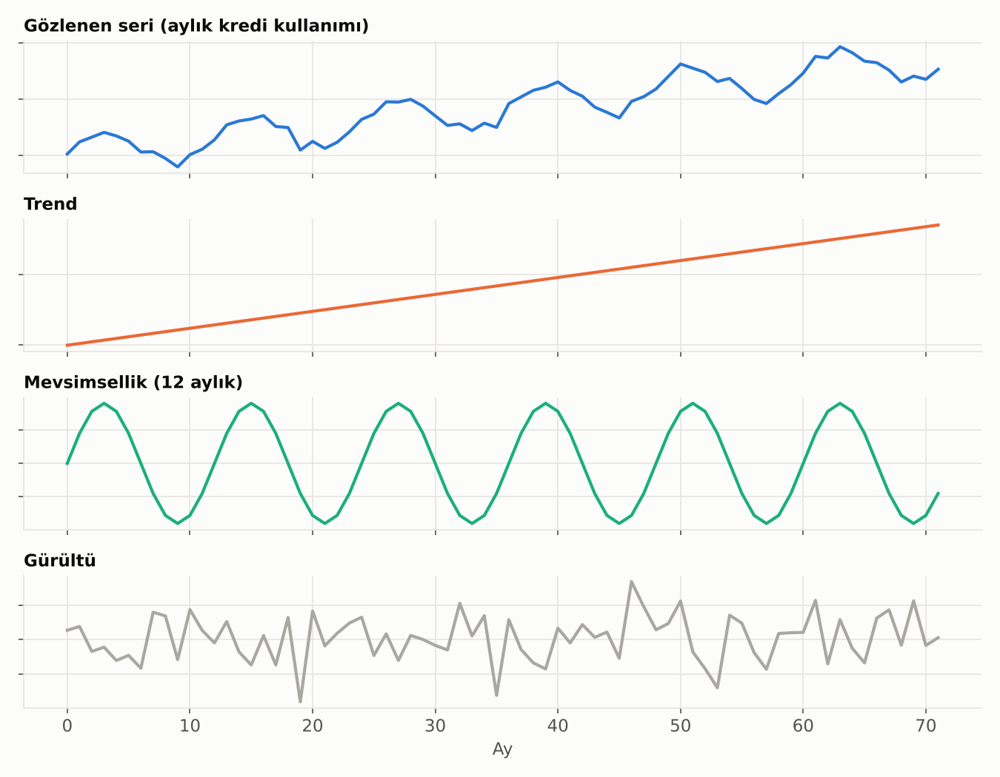
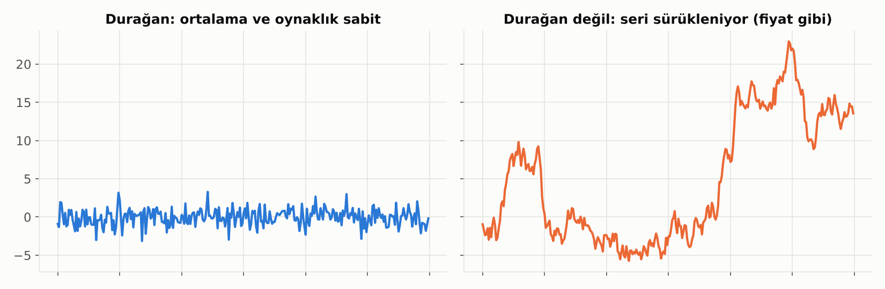
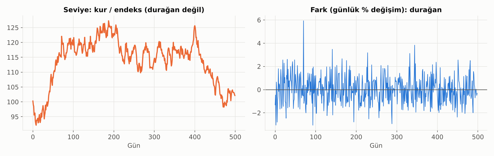
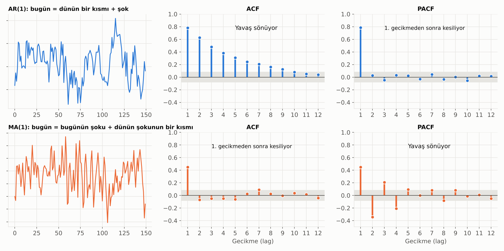

# 11. Zaman Serisi Temelleri

Zaman içinde ölçülen verinin (aylık kredi hacmi, günlük mevduat, kur, enflasyon) kendine özgü kuralları vardır: **dün, bugünü etkiler.** Klasik istatistikteki "gözlemler bağımsızdır" varsayımı burada geçerli değildir. Zaman serisi yöntemlerinin hepsi bu bağımlılığı modellemek için vardır.

## Zaman Serisinin Bileşenleri

Bir zaman serisi genelde dört parçaya ayrılır:

| Bileşen | Ne demek? | Bankacılık örneği |
|---|---|---|
| **Trend** | Uzun vadeli yön | Enflasyonla birlikte büyüyen nominal kredi hacmi |
| **Mevsimsellik** | Sabit periyotla tekrar eden desen | Yılbaşı ve bayram öncesi kart harcaması, maaş günü mevduat girişi, çeyrek sonu bilanço şişmesi |
| **Döngü** | Periyodu sabit olmayan, uzun dalgalar | Ekonomik genişleme ve daralma dönemleri, kredi döngüsü |
| **Düzensiz (gürültü)** | Geriye kalan rastgele dalgalanma | Beklenmeyen tek seferlik hareketler |

### Toplamsal ve Çarpımsal Yapı

- **Toplamsal:** Mevsimsel etki her yıl **aynı miktarda** (ör. her aralıkta +50 milyon TL).
- **Çarpımsal:** Mevsimsel etki **seri büyüdükçe büyür** (ör. her aralıkta %10 artış). Nominal TL serilerinde genelde bu durum görülür. Log almak çarpımsal yapıyı toplamsala çevirir.

**Ayrıştırma yöntemleri:** Klasik hareketli ortalama ayrıştırması, **STL** (aykırı değerlere dayanıklı ve esnek) ve resmi istatistiklerde kullanılan **X-13 ARIMA-SEATS**. TÜİK'in "mevsim ve takvim etkisinden arındırılmış" serileri bu tür yöntemlerle üretilir.

> 💡 Takvim etkisi mevsimsellikten ayrı düşünülmeli: Bayramların her yıl farklı aya denk gelmesi, ayın kaç iş günü içerdiği ve ayın kaç cuma içerdiği bankacılık serilerini ciddi şekilde etkiler.

## Durağanlık

**Durağan** bir serinin istatistiksel özellikleri zaman içinde değişmez:
- Ortalaması sabittir (bir trend yoktur),
- Dalgalanması (varyansı) sabittir,
- Bugün ile 3 gün öncesi arasındaki ilişki, hangi tarihe bakarsan bak aynıdır.

**Neden önemli?** ARIMA, VAR gibi modellerin çoğu durağan seri ister. Mantığı basit: Geçmişten öğrenilen desenin gelecekte de geçerli olması için serinin "kurallarının" değişmemesi gerekir. Sürekli yukarı sürüklenen bir serinin ortalaması diye bir şey yoktur; model neyi öğreneceğini bilemez.

Fiyatlar, kurlar, endeksler ve hacimler genelde durağan **değildir**. Bunların **değişimleri** (getiriler, aylık büyüme oranları) çoğunlukla durağana yakındır.

> ⚠️ **Sahte regresyon:** Durağan olmayan iki seriyi (ör. iki farklı ülkenin GSYH'si) birbirine regresyonla bağlarsan, aralarında hiçbir ilişki yokken çok güçlü bir ilişki ve yüksek R² bulursun. Çünkü ikisi de zamanla büyüyor. Önce durağanlaştır ya da eşbütünleşmeyi test et (bkz. [VAR ve VECM](14_var_vecm.md)).

### Durağanlaştırma: Fark Alma

En yaygın yöntem **fark almak**tır: Seviye yerine bir dönemden diğerine **değişimi** modellemek.

- **Birinci fark:** Bugün eksi dün. Trendi giderir.
- **Log fark:** Logaritmanın farkı, yaklaşık yüzde değişimdir. Hem trendi hem de seri büyüdükçe büyüyen dalgalanmayı giderir.
- **Mevsimsel fark:** Bu ay eksi geçen yılın aynı ayı. Mevsimselliği giderir (yıllık büyüme oranları buna benzer).
- Bir kez fark almak çoğu zaman yeterlidir; iki kezden fazlası nadiren gerekir ve seriyi aşırı farklamak yeni sorunlar yaratır.

### Durağanlık Testleri

| Test | Sıfır hipotezi | p < 0.05 ise |
|---|---|---|
| **ADF** (Augmented Dickey-Fuller) | Seri durağan **değil** (birim kök var) | Seri durağan |
| **KPSS** | Seri durağan | Seri durağan **değil** |
| **Phillips-Perron** | Seri durağan değil | Seri durağan |

ADF ve KPSS'nin hipotezleri birbirinin tersi olduğu için ikisi **birlikte** kullanılır:

| ADF | KPSS | Yorum |
|---|---|---|
| Durağan | Durağan | ✓ Seri durağan |
| Durağan değil | Durağan değil | ✗ Fark al |
| Durağan | Durağan değil | Fark durağan olabilir; dikkatli ol |
| Durağan değil | Durağan | Trend-durağan olabilir; trendi çıkar |

> 💡 Yapısal kırılmalar (kur şoku, pandemi, düzenleme değişikliği) testleri yanıltır: Kırılmalı ama durağan bir seri, durağan değilmiş gibi görünebilir. Seriyi mutlaka önce grafikle incele.

## Otokorelasyon: ACF ve PACF

**Otokorelasyon**, serinin kendi geçmişiyle korelasyonudur: "Bu ay yüksekse gelecek ay da yüksek olur mu?"

- **ACF (otokorelasyon fonksiyonu):** Bugün ile 1, 2, 3… dönem öncesi arasındaki **toplam** ilişki. Dolaylı etkileri de içerir: Bugün 2 gün öncesine benziyorsa, bunun sebebi her ikisinin de dünle ilişkili olması olabilir.
- **PACF (kısmi otokorelasyon fonksiyonu):** Aradaki dönemlerin etkisi çıkarıldıktan sonra kalan **doğrudan** ilişki.
- Gri bant istatistiksel anlamlılık sınırıdır; bandın dışına çıkan çubuklar anlamlıdır.

Bu iki grafik, bir sonraki bölümdeki ARIMA modelinin derecelerini seçmek için kullanılır:
- **AR süreci:** ACF yavaş söner, PACF belirli bir gecikmeden sonra aniden kesilir.
- **MA süreci:** ACF belirli bir gecikmeden sonra aniden kesilir, PACF yavaş söner.
- **Mevsimsellik:** ACF'de 12, 24, 36. gecikmelerde (aylık veride) tekrar eden tepeler görülür.

## Zaman Serisinde Model Kurmanın Altın Kuralları

- **Geçmişle eğit, gelecekle test et.** Rastgele bölme, modelin geleceği görmesine yol açar. **Kayan pencere (rolling / walk-forward)** doğrulama kullan.
- **Önce basit bir referans kur.** "Gelecek ay = bu ay" (naive) ya da "gelecek ay = geçen yılın aynı ayı" (mevsimsel naive) tahminlerini geçemeyen model işe yaramaz.
- **Belirsizliği göster.** Tek bir tahmin çizgisi yerine güven aralığı ver; ufuk uzadıkça aralık genişler.

**Bu bölümden sonra:**
- Tek bir serinin **seviyesini** tahmin etmek → [ARIMA ve SARIMA](12_arima_sarima.md)
- Tek bir serinin **oynaklığını** modellemek → [ARCH, GARCH ve Türevleri](13_arch_garch.md)
- **Birden çok** serinin birbirini nasıl etkilediğini modellemek → [VAR ve VECM](14_var_vecm.md)

---

[← 10. Model Değerlendirme](10_model_degerlendirme.md) · [Bölümler](../README.md#bölümler) · [12. ARIMA ve SARIMA →](12_arima_sarima.md)
