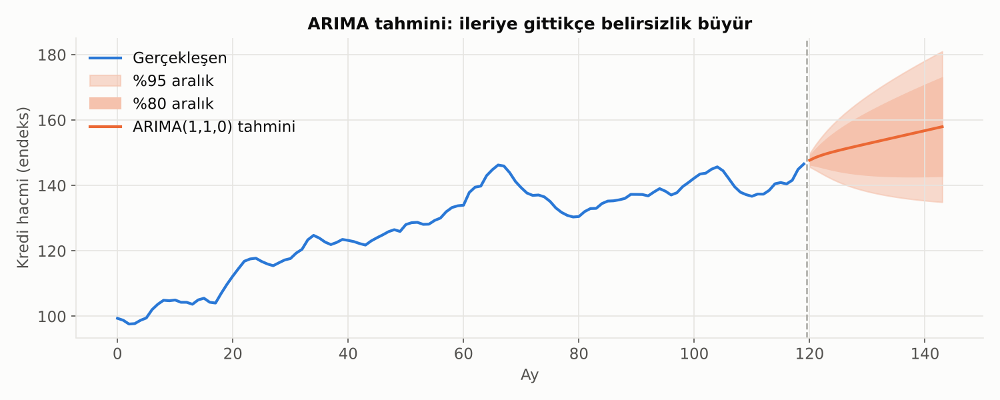
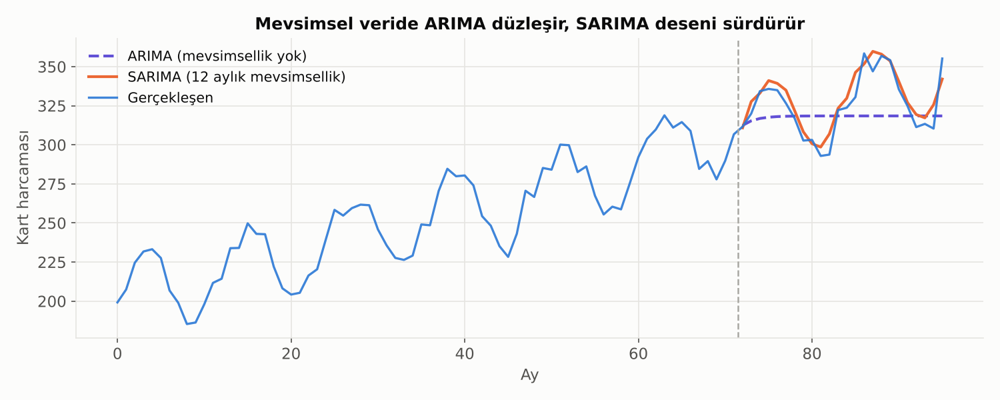

# 12. ARIMA ve SARIMA

ARIMA, tek bir zaman serisini **kendi geçmişini** kullanarak tahmin eden klasik modeldir. Fikir basittir: Bugünkü değer, geçmiş değerlerin ve geçmişteki sürprizlerin (şokların) bir karışımıdır.

## İsim Neden ARIMA?

ARIMA üç parçadan oluşur; her parçanın bir **derecesi** vardır ve model **ARIMA(p, d, q)** diye yazılır.

| Parça | Açılımı | Ne yapar? | Derece |
|---|---|---|---|
| **AR** | AutoRegressive (öz bağlanımlı) | Bugünü, serinin **kendi geçmiş değerlerine** bağlar | **p:** Kaç dönem geriye bakılacağı |
| **I** | Integrated (bütünleşik) | Seriyi durağan yapmak için **fark alır** | **d:** Kaç kez fark alınacağı |
| **MA** | Moving Average (hareketli ortalama) | Bugünü, **geçmiş tahmin hatalarına (şoklara)** bağlar | **q:** Kaç dönem geriye ait şokun etkili olduğu |

### AR: Hafıza

"Bu ay kredi büyümesi yüksekse gelecek ay da büyük ihtimalle yüksek olur." AR modeli, serinin **ataletini** yakalar. AR(1)'de bugün = dünün belli bir kısmı + yeni şok. Dünün katsayısı 1'e ne kadar yakınsa seri o kadar "yapışkan"dır, şoklar o kadar uzun sürer.

### MA: Şokların Kısa Süreli Etkisi

"Geçen ay beklenmedik bir kampanya oldu, etkisi bu ay da biraz sürüyor ama sonra tamamen geçecek." MA modeli, bir şokun **sınırlı bir süre** etkisini sürdürmesini yakalar. AR'dan farkı: MA'da şok q dönem sonra **tamamen** kaybolur; AR'da ise giderek azalarak sonsuza kadar sürer.

> ⚠️ Buradaki "hareketli ortalama", grafiklerde kullanılan 20 günlük hareketli ortalama ile aynı şey değildir. İsim benzerliği kafa karıştırmasın.

### I: Durağanlaştırma

AR ve MA durağan seri ister. Seri trendliyse önce farkı alınır (d = 1), model fark alınmış seriye kurulur, tahminler sonra tekrar seviyeye çevrilir.

## ARIMA Nasıl Kurulur? (Box-Jenkins Yaklaşımı)

1. **Grafiğe bak:** Trend, mevsimsellik, yapısal kırılma, aykırı değer var mı?
2. **Durağanlaştır:** Gerekirse log al (varyansı sabitlemek için), sonra fark al. ADF/KPSS ile kontrol et → **d** belirlenir.
3. **Dereceleri seç:** Durağan serinin ACF ve PACF grafiklerine bak (bkz. [Zaman Serisi Temelleri](11_zaman_serisi_temelleri.md)):
   - PACF p gecikmesinden sonra kesiliyorsa → AR(p)
   - ACF q gecikmesinden sonra kesiliyorsa → MA(q)
   - İkisi de yavaş sönüyorsa → ARMA(p, q)
4. **Alternatif modelleri karşılaştır:** **AIC** veya **BIC** değeri en düşük olan model tercih edilir. Bu kriterler, uyum iyiliğini ödüllendirip gereksiz karmaşıklığı cezalandırır. (Pratikte `auto_arima` gibi araçlar bu taramayı otomatik yapar.)
5. **Artıkları kontrol et:** İyi bir modelin hataları **beyaz gürültü** olmalı: otokorelasyonsuz, ortalaması sıfır. **Ljung-Box testi** artıklarda kalan otokorelasyonu test eder (p > 0.05 istenir).
6. **Tahmin et ve test et:** Geçmişin bir kısmını ayırıp modelin o dönemi ne kadar iyi tahmin ettiğine bak.

### ARIMA Tahmininin Doğası

- Kısa vadede serinin son hareketini ve ataletini kullanır.
- Uzun vadede tahmin, serinin ortalamasına (fark alınmış modelde ise sabit bir eğilime) yaklaşır ve **düzleşir**.
- **Belirsizlik ufukla birlikte büyür.** Bir yıl sonrası için verilen tek bir sayı, aralığı gösterilmeden sunulmamalıdır.

## SARIMA: Mevsimsellik Eklenmiş ARIMA

Aylık kart harcaması her aralıkta zirve yapıyorsa, ARIMA bunu göremez: Sadece son birkaç aya bakar. **SARIMA**, aynı AR-I-MA mantığını **mevsimsel gecikmelere** de uygular: "Bu aralık, **geçen aralığa** benzeyecek."

Model **SARIMA(p, d, q)(P, D, Q)s** diye yazılır:
- Küçük harfler (p, d, q): Normal ARIMA kısmı (son birkaç döneme bakış).
- Büyük harfler (P, D, Q): Mevsimsel kısım (geçen yılın aynı dönemine bakış).
- **s:** Mevsim uzunluğu. Aylık veride 12, çeyreklik veride 4, günlük veride haftalık desen için 7.

Örneğin **SARIMA(1,1,1)(0,1,1)12**: Seriden hem bir aylık fark hem de 12 aylık (yıllık) fark alınır, son ayın etkisi ve geçen yılın aynı ayının şoku modele katılır. Bu yapı, uçak yolcu sayısı gibi klasik serilerde öyle iyi çalışır ki "havayolu modeli" diye anılır.

Grafikte mevsimsellik içermeyen ARIMA tahmini düz bir çizgiye dönüşürken, SARIMA yıllık dalgalanmayı tahmin dönemine taşıyor.

## Uzantılar

- **ARIMAX / SARIMAX:** Modele dış değişken eklenir. Örneğin kredi hacmi tahminine politika faizini, bayram kuklasını (dummy) veya kampanya dönemlerini koymak.
- **Birden çok mevsimsellik:** Günlük veride hem haftalık hem yıllık desen varsa SARIMA zorlanır; TBATS, Prophet veya Fourier terimleri eklenmiş regresyon kullanılır.

## Ne Zaman ARIMA, Ne Zaman Başka Bir Şey?

**ARIMA iyi çalışır:**
- Tek bir seri, kısa-orta vadeli tahmin,
- Düzenli yapı, yeterince uzun geçmiş (mevsimsel modelde en az birkaç yıl),
- Yorumlanabilirlik ve güven aralığı isteniyorsa.

**ARIMA zorlanır:**
- Yapısal kırılmalar (kur şoku, düzenleme değişikliği, pandemi),
- Binlerce seriyi aynı anda tahmin etmek (ör. her şube için ayrı model) → gradient boosting gibi küresel modeller daha pratik olabilir,
- Uzun vadeli tahmin,
- Oynaklığın kendisinin değiştiği seriler → [ARCH / GARCH](13_arch_garch.md).

> 💡 ARIMA, serinin **ortalamasını (seviyesini)** modeller ve şokların büyüklüğünün hep aynı olduğunu varsayar. Finansal getirilerde ise asıl hikâye çoğu zaman şokların **büyüklüğünün** değişmesidir. Bir sonraki bölümün konusu tam olarak bu.

---

[← 11. Zaman Serisi Temelleri](11_zaman_serisi_temelleri.md) · [Bölümler](../README.md#bölümler) · [13. ARCH, GARCH ve Türevleri: Oynaklığı Modellemek →](13_arch_garch.md)
