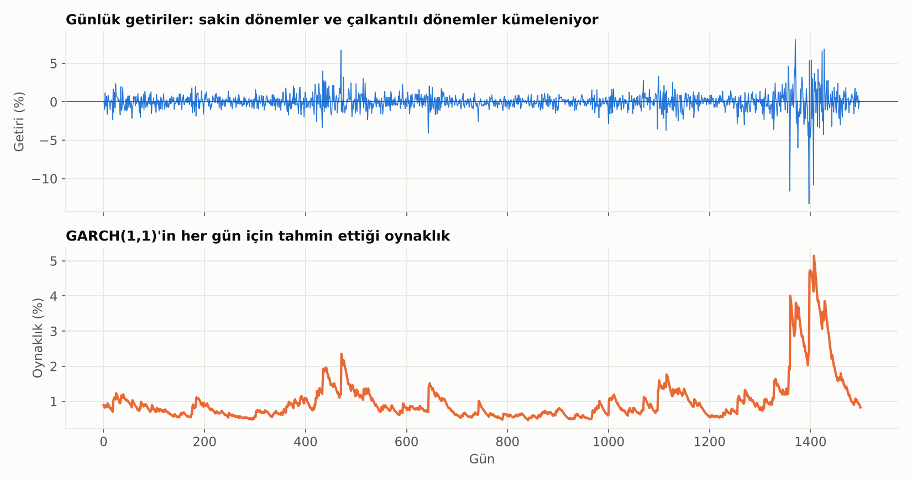
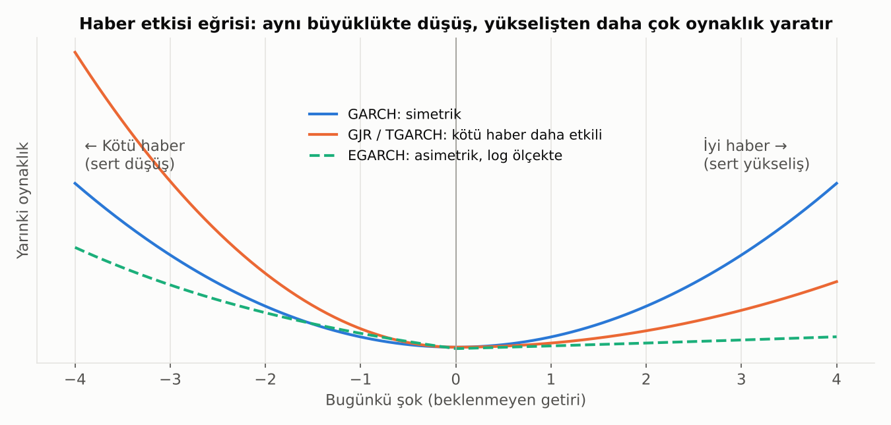

# 13. ARCH, GARCH ve Türevleri: Oynaklığı Modellemek

## Problem: Oynaklık Sabit Değil

ARIMA, şokların büyüklüğünün (varyansın) zaman içinde **sabit** olduğunu varsayar. Finansal piyasalarda bu varsayım açıkça yanlıştır:

Üstteki günlük getirilere bak: Sakin dönemler uzun süre sakin, çalkantılı dönemler de uzun süre çalkantılı geçiyor. Buna **volatilite kümelenmesi** denir: "Büyük hareketleri büyük hareketler, küçük hareketleri küçük hareketler izler."

Getirilerin **yönünü** tahmin etmek çok zordur. Ama **ne kadar oynak** olacaklarını tahmin etmek mümkündür. ARCH ailesi modeller tam olarak bunu yapar: Ortalamayı değil, **varyansı** modeller.

**Neden önemli?**
- **Piyasa riski (VaR, beklenen kayıp):** Bugünkü risk, geçen yılın ortalama oynaklığıyla değil, **bugünün** oynaklığıyla ölçülmelidir.
- **Opsiyon fiyatlaması:** Opsiyon fiyatı, beklenen oynaklığa bağlıdır.
- **Portföy ve hedge kararları:** Oynaklık arttığında pozisyon büyüklüğünü ayarlamak.
- **Kur ve faiz riski:** TL kurunun oynaklığını tahmin etmek, döviz pozisyon limitlerini belirlemek.

## ARCH: İlk Fikir

**ARCH** (AutoRegressive Conditional Heteroskedasticity, otoregresif koşullu değişen varyans), 1982'de Robert Engle tarafından geliştirildi (2003 Nobel Ekonomi Ödülü).

Fikir: **Yarının oynaklığı, son birkaç günün şoklarının büyüklüğüne bağlıdır.** Dün sert bir hareket olduysa (yukarı ya da aşağı), bugün de oynaklık yüksek beklenir.

- **"Koşullu"**: Varyans, geçmişte olanlara **bağlı olarak** değişir.
- **ARCH(q)**: Son q günün şoklarına bakılır.

**Sorunu:** Oynaklığın uzun süren hafızasını yakalamak için çok sayıda gecikme (q) gerekir, model hantallaşır.

## GARCH: Standart Model

**GARCH** (Generalized ARCH), 1986'da Tim Bollerslev tarafından önerildi ve bugün sektör standardıdır. Yarının oynaklığını üç parçanın birleşimi olarak görür:

1. **Uzun dönem ortalama oynaklık:** Oynaklığın eninde sonunda döndüğü seviye.
2. **Dünün şoku (ARCH terimi):** Dün ne kadar sert bir hareket oldu? → Habere **tepki**.
3. **Dünün oynaklığı (GARCH terimi):** Dün oynaklık ne kadardı? → **Hafıza**.

**GARCH(1,1)**, yani bir gün öncesinin şoku ve bir gün öncesinin oynaklığı, finansal serilerin büyük çoğunluğu için yeterlidir. Alt grafikte GARCH(1,1)'in her gün için tahmin ettiği oynaklık görülüyor: Çalkantılı dönemde hızla yükseliyor, sonra yavaş yavaş normale dönüyor.

### Katsayıların Yorumu

- **Şok katsayısı büyükse:** Oynaklık habere hızlı ve sert tepki verir.
- **Hafıza katsayısı büyükse:** Yüksek oynaklık uzun süre kalıcı olur.
- **İkisinin toplamı (kalıcılık):** 1'e ne kadar yakınsa, şoklar o kadar uzun sürer. Hisse ve kur getirilerinde genelde **0.95–0.99** aralığındadır. Toplam 1'e eşit veya büyükse oynaklık "patlar", model durağan değildir.
- **Yarı ömür:** Bir oynaklık şokunun etkisinin yarıya inmesi için geçen süre; kalıcılıktan hesaplanır ve kriz sonrası normalleşmenin ne kadar süreceği hakkında fikir verir.

> 💡 RiskMetrics'in meşhur **EWMA** yöntemi (üstel ağırlıklı hareketli ortalama ile oynaklık), aslında uzun dönem ortalaması olmayan özel bir GARCH(1,1)'dir. Uzun vadede ortalamaya dönüşü olmadığı için ileri vadeli oynaklık tahminlerinde GARCH'tan farklı davranır.

## Asimetri: Kötü Haber Daha Çok Sarsar

GARCH **simetriktir**: %3'lük bir düşüş ile %3'lük bir yükseliş, yarınki oynaklığı aynı miktarda artırır. Gerçekte ise piyasalar böyle davranmaz: **Sert düşüşler, aynı büyüklükteki yükselişlerden çok daha fazla oynaklık yaratır.** Bu, **kaldıraç etkisi** olarak bilinir: Hisse fiyatı düşünce şirketin borç/özsermaye oranı artar, şirket riskli hale gelir; ayrıca panik satışları korkuyu besler.

**Haber etkisi eğrisi**, bugünkü şokun yarınki oynaklığa etkisini gösterir. GARCH'ta eğri simetrik bir U'dur; asimetrik modellerde sol kol (kötü haber) daha diktir.

### EGARCH (Exponential GARCH)

Daniel Nelson (1991) tarafından önerildi.
- Oynaklığın **logaritmasını** modeller. Bu sayede oynaklık hiçbir zaman negatif olamaz ve katsayılara pozitiflik kısıtı koymaya gerek kalmaz.
- Şokun **büyüklüğü** ve **işareti** (iyi mi kötü mü) ayrı ayrı modele girer. İşaret katsayısı negatif ve anlamlıysa kaldıraç etkisi vardır.
- Çarpımsal yapısı sayesinde çok büyük şoklara karşı daha dengeli tepki verir.

### GJR-GARCH ve TARCH / TGARCH (Threshold GARCH)

Glosten, Jagannathan ve Runkle (1993) ile Zakoian (1994) tarafından önerildi.
- Mantık daha basit: GARCH'a bir **eşik (threshold)** ekler. Dünün şoku **negatifse**, yarınki oynaklığa **ek bir pay** eklenir.
- Yani iyi haber normal etkiyi, kötü haber "normal etki + ekstra" yaratır.
- Bu ek payın katsayısı pozitif ve anlamlıysa asimetri vardır.
- **GJR-GARCH** varyansı, **TGARCH** standart sapmayı modeller; fikir aynıdır ve isimler pratikte çoğu zaman birbirinin yerine kullanılır.

| Model | Asimetri | Neyi modeller? | Ne zaman tercih edilir? |
|---|---|---|---|
| **ARCH** | Yok | Varyans, sadece geçmiş şoklar | Tarihsel / eğitim amaçlı; pratikte nadiren |
| **GARCH** | Yok | Varyans, şoklar + geçmiş oynaklık | Başlangıç modeli; kur gibi asimetrinin zayıf olduğu seriler |
| **EGARCH** | Var | Log-varyans | Hisse endeksleri, güçlü kaldıraç etkisi, kısıtsız tahmin |
| **GJR / TGARCH** | Var | Varyans (eşikli) | Asimetriyi basit ve yorumlanabilir şekilde test etmek |

## Pratik Notlar

- **Model iki katlıdır:** Önce getirinin **ortalaması** için bir denklem kurulur (genelde sabit ya da küçük bir AR), sonra hataların **varyansı** GARCH ile modellenir. ARIMA ve GARCH bu şekilde birleştirilebilir (ARMA-GARCH).
- **Hata dağılımı:** Getiriler kalın kuyrukludur; normal dağılım yerine **Student-t** veya çarpık-t dağılımı kullanmak genelde uyumu belirgin şekilde iyileştirir.
- **Önce test et:** Getirilerin karelerinde otokorelasyon var mı? (Ljung-Box) ya da doğrudan **ARCH-LM testi**. Etki yoksa GARCH'a gerek yoktur.
- **Artıkları kontrol et:** Standartlaştırılmış artıkların karelerinde otokorelasyon kalmamalı.
- **Model seçimi:** AIC/BIC, ama asıl test **geriye dönük VaR testidir** (backtesting): Model "%1 ihtimalle bu kadar kaybederiz" diyorsa, gerçekte günlerin yaklaşık %1'inde bu sınır aşılmış mı?
- **Python:** `arch` kütüphanesi (`arch_model(..., vol="GARCH", p=1, o=1, q=1)` ile GJR, `vol="EGARCH"` ile EGARCH).

> 💡 GARCH ailesi **tek bir serinin** oynaklığını modeller. Birden çok varlığın oynaklıklarının ve **korelasyonlarının** birlikte değişmesi için (portföy riski) çok değişkenli GARCH modelleri (DCC-GARCH, BEKK) kullanılır.

---

[← 12. ARIMA ve SARIMA](12_arima_sarima.md) · [Bölümler](../README.md#bölümler) · [14. VAR ve VECM: Birbirini Etkileyen Seriler →](14_var_vecm.md)
