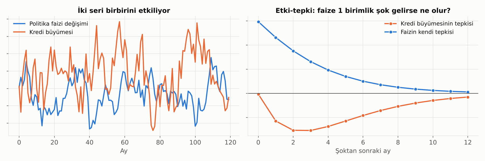
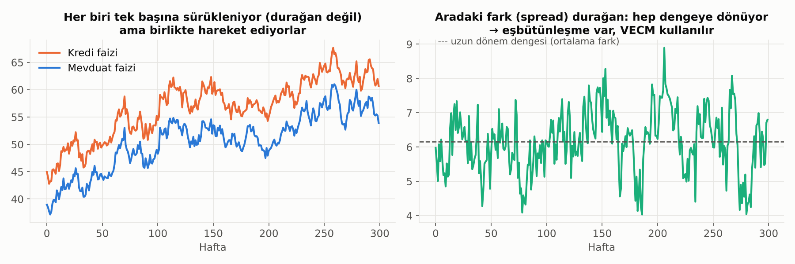

# 14. VAR ve VECM: Birbirini Etkileyen Seriler

ARIMA ve GARCH tek bir seriyle ilgilenir. Ekonomide ve bankacılıkta ise değişkenler birbirini **karşılıklı** etkiler: Politika faizi kredi faizini, kredi faizi kredi büyümesini, kredi büyümesi enflasyonu, enflasyon da yeniden politika faizini etkiler. Bu döngüyü modellemek için **çok değişkenli** zaman serisi modelleri kullanılır.

> ⚠️ Buradaki **VAR (Vector AutoRegression)**, risk yönetimindeki **VaR (Value at Risk, riske maruz değer)** ile aynı şey değildir. İsim benzerliği tesadüftür.

## VAR: Vektör Otoregresyon

### Fikir

VAR, AR modelinin çok değişkenli halidir. Sistemdeki **her değişken**, hem **kendi geçmişiyle** hem de **diğer tüm değişkenlerin geçmişiyle** açıklanır. Hangi değişkenin "neden", hangisinin "sonuç" olduğuna önceden karar vermek gerekmez; herkes herkesi etkileyebilir.

İki değişkenli bir VAR(1) örneği:
- Bu ayki faiz değişimi = geçen ayki faiz değişimi + geçen ayki kredi büyümesi + şok
- Bu ayki kredi büyümesi = geçen ayki faiz değişimi + geçen ayki kredi büyümesi + şok

**VAR(p)**'deki p, geriye kaç dönem bakıldığıdır. AIC, BIC veya HQ kriterleriyle seçilir. Değişken ve gecikme sayısı arttıkça tahmin edilecek katsayı sayısı hızla büyür; bu yüzden VAR modelleri genelde 2–6 değişkenle sınırlı tutulur.

### VAR'ın Şartı: Durağanlık

Klasik VAR, **tüm serilerin durağan** olmasını ister. Seviyesi sürüklenen seriler (kredi hacmi, kur, fiyat endeksi) önce farklanır ya da büyüme oranlarına çevrilir. Ancak burada dikkat: Seriler birlikte hareket ediyorsa farklamak önemli bir bilgiyi yok eder. Bu durumda VECM gerekir (aşağıda).

### VAR'dan Ne Öğreniriz?

Katsayıların kendisi tek tek yorumlanmaz; çok sayıdadır ve birbirine karışır. Bunun yerine üç araç kullanılır:



**1. Etki-tepki fonksiyonu (Impulse Response Function, IRF)**
"Politika faizine bugün beklenmedik 1 birimlik bir şok gelirse, kredi büyümesi önümüzdeki aylarda nasıl tepki verir?" Grafikte faiz şokundan sonra kredi büyümesi düşüyor, tepkinin en sert olduğu nokta 2–3 ay sonra ve etki yaklaşık bir yılda sönüyor. Para politikasının aktarım mekanizması analizlerinin temel aracıdır.

**2. Varyans ayrıştırması (Forecast Error Variance Decomposition)**
"Kredi büyümesindeki tahmin edilemeyen dalgalanmanın yüzde kaçı faiz şoklarından, yüzde kaçı kendi şoklarından kaynaklanıyor?" Hangi değişkenin sistemi daha çok sürüklediğini gösterir.

**3. Granger nedenselliği**
"Faizin geçmişi, kredi büyümesini **tahmin etmeye** yardımcı oluyor mu?" Evetse faiz, kredi büyümesinin Granger nedenidir.
> ⚠️ Granger nedenselliği gerçek nedensellik değildir; sadece **zamansal öncelik ve tahmin gücü** demektir. Hava durumu tahmini yağmurun "Granger nedeni" olabilir ama yağmura sebep olmaz.

### Şokların Sıralaması

Etki-tepki analizinde değişkenler aynı ay içinde de birbirini etkileyebilir. Bu eşzamanlı etkileri ayırmak için bir varsayım gerekir. En yaygın yol **Cholesky sıralaması**dır: Sıradaki ilk değişken diğerlerini aynı ay içinde etkiler ama onlardan etkilenmez. Örneğin "Merkez Bankası faizi ay içinde kredi büyümesine tepki vermez, ama kredi büyümesi faize aynı ay tepki verebilir." **Sonuçlar bu sıralamaya duyarlı olabilir**; teoriyle gerekçelendirilmeli ve farklı sıralamalarla denenmelidir. Daha yapılandırılmış varsayımlarla kurulan modellere **SVAR** (yapısal VAR) denir.

## Eşbütünleşme (Cointegration)

Bazı seriler tek tek bakınca rastgele sürüklenir (durağan değildir), ama **birlikte** hareket eder; aralarındaki fark kalıcı olarak açılmaz.



Kredi faizi ile mevduat faizi buna iyi bir örnektir: İkisi de zamanla iner ve çıkar, ama aradaki marj (spread) belirli bir seviye etrafında dalgalanır ve hep ona geri döner. İki seri arasında **uzun dönemli bir denge ilişkisi** vardır.

Benzetme: Sarhoş bir adam ve köpeği. İkisi de rastgele yürür, nereye gidecekleri tahmin edilemez. Ama adam köpeği tasmayla tutuyorsa, aralarındaki mesafe hiçbir zaman çok açılmaz. Tasma, eşbütünleşme ilişkisidir.

Diğer örnekler:
- Spot ve vadeli (futures) fiyatlar
- Tüketim ve gelir
- Farklı vadelerdeki faizler
- Aynı malın farklı piyasalardaki fiyatları

### Eşbütünleşme Testleri

| Test | Ne zaman? |
|---|---|
| **Engle-Granger** | İki değişken; basit. Regresyonun artıkları durağansa eşbütünleşme var. |
| **Johansen** | İki veya daha fazla değişken; **kaç tane** denge ilişkisi olduğunu (eşbütünleşme rankı) bulur. VECM öncesinde standart test. |

## VECM: Vektör Hata Düzeltme Modeli

Seriler eşbütünleşikse iki kötü seçenek vardır:
- **Seviyelerle VAR** kurmak: Seriler durağan değil, sahte ilişkiler riski.
- **Farklarla VAR** kurmak: Uzun dönem denge bilgisini çöpe atmak.

**VECM** ikisini birleştirir. Her değişkenin değişimini iki parçayla açıklar:

1. **Kısa dönem dinamikleri:** Geçmiş değişimler (farklarla VAR gibi).
2. **Hata düzeltme terimi:** Geçen dönem sistem dengeden **ne kadar uzaklaşmıştı?** Uzaklaştıysa, değişkenler bu açığı kapatacak yönde hareket eder.

Örneğin kredi–mevduat marjı normalin çok üstüne çıktıysa, gelecek dönemlerde ya kredi faizi düşer ya mevduat faizi yükselir ya da ikisi birden olur; marj dengeye döner.

### Ayarlanma Hızı

Hata düzeltme teriminin katsayısı (**ayarlanma hızı**), dengeden sapmanın her dönem ne kadarının kapandığını gösterir. Örneğin −0.25 ise sapmanın yaklaşık dörtte biri her ay kapanır. Bu katsayının işareti doğru (dengeye çekecek yönde) ve anlamlı olmalıdır. Hangi değişkenin ayarlanma katsayısı anlamlıysa, **dengeye dönüş yükünü o taşır.** Örneğin mevduat faizi ayarlanırken kredi faizi ayarlanmıyorsa, bankalar marjı mevduat tarafından düzeltiyor demektir.

## Hangi Model? Karar Akışı

```
Seriler durağan mı? (ADF / KPSS)
├── Evet ────────────────────────────────→ VAR (seviyelerle)
└── Hayır → Farkları durağan mı?
            └── Evet → Eşbütünleşme var mı? (Johansen)
                       ├── Hayır ────────→ VAR (farklarla)
                       └── Evet ─────────→ VECM
```

## Bankacılıkta Kullanım Alanları

- **Stres testleri:** Makro senaryolarını (büyüme, işsizlik, kur, faiz) kredi kalitesine ve takipteki krediler oranına bağlamak.
- **Para politikası aktarımı:** Politika faizindeki değişimin kredi ve mevduat faizlerine ne kadar ve ne hızla yansıdığı.
- **Mevduat ve kredi fiyatlaması:** Faiz geçişkenliğinin (pass-through) ölçülmesi, marj dinamiklerinin modellenmesi.
- **ALM ve likidite planlaması:** Mevduat hacmi, faiz ve kur arasındaki etkileşimler.
- **Makro tahmin:** Birbirini etkileyen göstergeleri birlikte tahmin etmek.

> 💡 VAR ve VECM, **yorumlama ve senaryo analizi** için güçlü araçlardır. Saf tahmin performansında ise çoğu zaman basit modelleri (hatta naive tahmini) çok az geçerler. Hangi amaçla kullandığını netleştir.

---

[← 13. ARCH, GARCH ve Türevleri: Oynaklığı Modellemek](13_arch_garch.md) · [Bölümler](../README.md#bölümler) · [15. Nedensellik ve Bayesçi Düşünce →](15_nedensellik_ve_bayesci_dusunce.md)
