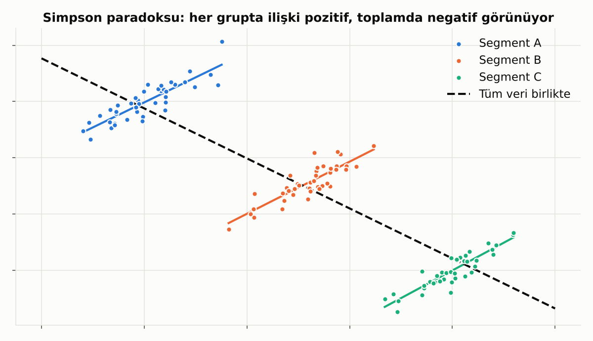
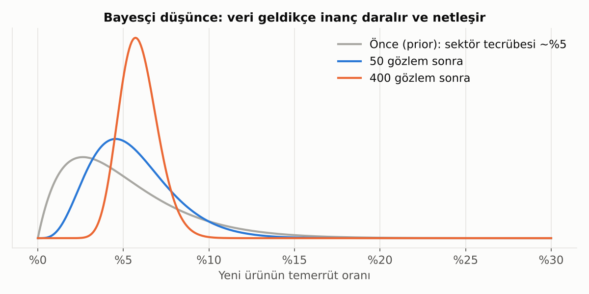

# 15. Nedensellik ve Bayesçi Düşünce

## Karıştırıcı Değişkenler ve Simpson Paradoksu

Bazen veriyi gruplara ayırınca ilişkinin yönü **tamamen tersine döner**.

Her segmentin içinde ilişki pozitif; ama segmentler birleştirilince negatif görünüyor. Sebep, segmentin kendisinin hem X'i hem Y'yi etkilemesi (**karıştırıcı değişken**).

**Bankacılık örneği:** "Kampanya alan müşteriler daha az kârlı" gibi bir sonuç, kampanyanın aslında zaten düşük kârlı segmentlere gönderilmiş olmasından kaynaklanabilir. Kampanyanın etkisini ölçmek için **segment içinde** karşılaştırma yapmak ya da rastgele bir kontrol grubu kullanmak gerekir.

> 💡 "X ile Y ilişkili" demek kolay. "X, Y'ye **neden oluyor**" demek için ya rastgele bir deney ya da karıştırıcıları dikkatle kontrol eden bir analiz gerekir.

## Bayesçi Düşünce

Klasik istatistik "veri ne diyor?" diye sorar. Bayesçi yaklaşım ise **önceki bilgiyi** (prior) veriyle birleştirir ve inancı adım adım günceller.

**Örnek:** Yeni bir kredi ürünü çıkardık, henüz çok az veri var. Sektör tecrübesi temerrüt oranının %5 civarında olduğunu söylüyor. İlk gözlemler geldikçe tahminimiz bu ön bilgiden veriye doğru kayar ve belirsizlik daralır.

**Ne zaman faydalı?**
- Az veriyle karar vermek gerektiğinde (yeni ürün, küçük segment).
- Belirsizliği açıkça ifade etmek istediğinde ("%90 ihtimalle oran %4-8 arası").

---

[← 14. VAR ve VECM: Birbirini Etkileyen Seriler](14_var_vecm.md) · [Bölümler](../README.md#bölümler) · [16. Canlıdaki Model: Dağılım Kayması →](16_dagilim_kaymasi.md)
