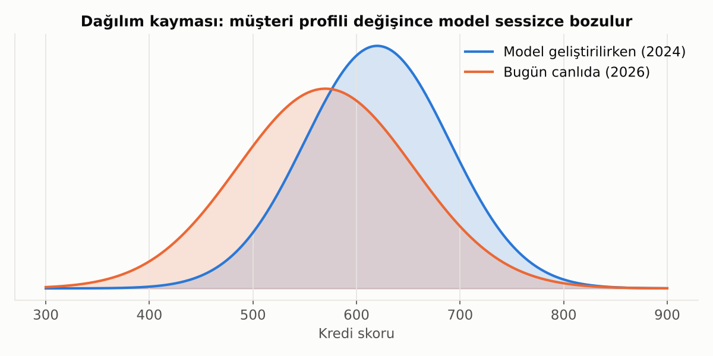

# 16. Canlıdaki Model: Dağılım Kayması

Model geliştirildiği gün mükemmel olabilir; ama dünya değişir. Faiz ortamı, müşteri profili, ekonomik koşullar değişince modelin gördüğü veri de değişir.

**İzlenmesi gerekenler:**
- **Girdi kayması:** Değişkenlerin dağılımı değişti mi? Bankacılıkta yaygın ölçüt **PSI** (Population Stability Index). Kaba bir kural: 0.10'un altı stabil, 0.10-0.25 arası dikkat, 0.25'in üstü ciddi kayma.
- **Performans kayması:** AUC/Gini, kalibrasyon ve gerçekleşen oranlar zaman içinde bozuluyor mu?
- **Kavram kayması:** Değişkenlerle sonuç arasındaki ilişkinin kendisi değişti mi? (ör. kriz döneminde aynı borç/gelir oranı farklı risk anlamına gelir)

> 💡 Model kurmak işin yarısıdır. Diğer yarısı onu **izlemek** ve gerektiğinde yeniden eğitmektir.

---

[← 15. Nedensellik ve Bayesçi Düşünce](15_nedensellik_ve_bayesci_dusunce.md) · [Bölümler](../README.md#bölümler) · [17. Özet Kontrol Listesi →](17_kontrol_listesi.md)
